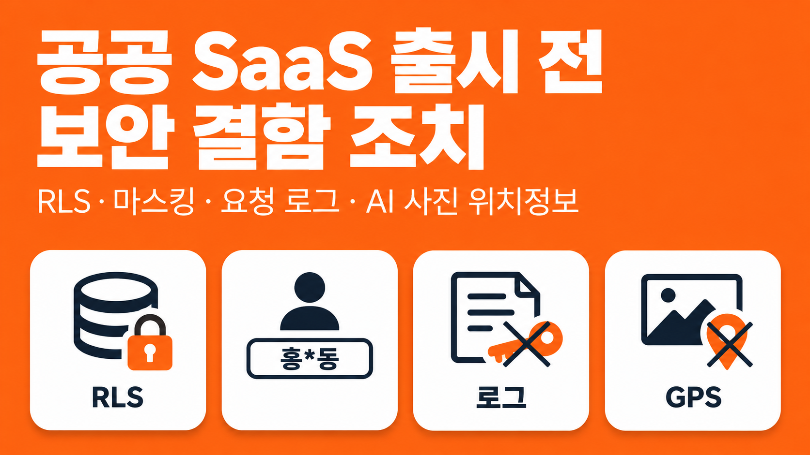
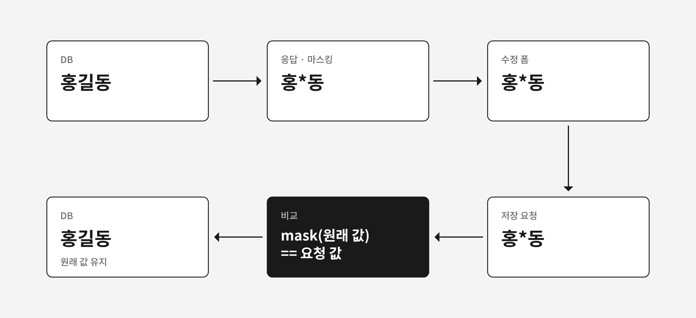
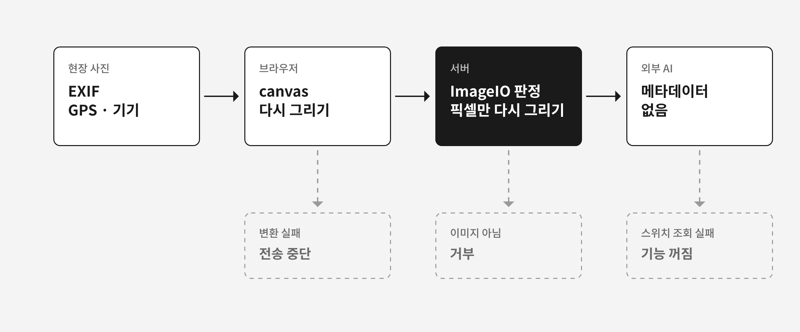

민간 기업용 SaaS를 공공기관용으로 갈라 만든 서비스를 출시 전에 검수하면서 보안 결함을 조치했다. 공공판은 CSAP(클라우드서비스 보안인증) SaaS 표준등급 대상이다. 그래서 PostgreSQL RLS(Row-Level Security)로 테넌트를 나누고, 개인정보 칸 암호화, 응답 마스킹, 세션 기반 사업장 확인을 필수 규칙으로 두었다. 이 장치들은 동료 개발자가 만들었고, 나는 기능에 적용하면서 검수에서 나온 결함을 고쳤다.

결함 대부분은 빠진 조건이나 권한 검사를 넣으면 끝나는 것이었다. 이 글은 그중 조치 방법을 따로 정해야 했던 네 건을 다룬다. 같은 검수에서 나온 토큰 쿠키 결함은 [토큰을 화면 JS에서 떼어 내기](/posts/nextjs-token-cookie-httponly-proxy)에서 따로 다룬다.

## 검수에서 나온 결함 7건

| 결함 | 조치 |
|---|---|
| 로그인 없이 여는 메일 링크가 빈 화면을 띄움 | 링크를 만든 사업장의 테넌트를 트랜잭션 하나에만 설정 |
| 마스킹한 이름을 그대로 저장하면 원래 이름이 덮어써짐 | 가린 값이 돌아오면 원래 값 유지, 수정은 개인정보취급자만 |
| 요청 로그 테이블이 요청 본문을 저장하도록 되어 있음 | 본문과 쿼리스트링을 저장 항목에서 제외 |
| 외부 AI로 보내는 사진에 GPS 위치가 담김 | 서버와 브라우저에서 메타데이터 제거, 기능 스위치 추가 |
| 공통 기준표 수정 권한을 "요청에 사업장 정보가 없으면 시스템 관리자"로만 판정 | 시스템 계정 확인 추가, 관리자 전용 경로로 분리 |
| 같은 테넌트 안에서 문서 번호만 바꾸면 다른 사업장 문서가 조회됨 | 쿼리에 세션 사업장 조건 추가 |
| 로그인 없이 서명하는 경로가 있음 | 서명을 로그인한 본인으로 한정 |

위의 네 건을 차례로 정리한다.

## 로그인 없는 메일 링크는 왜 빈 화면이었나

서비스가 보내는 메일에는 문서 바로가기 링크가 있고, 이 링크는 로그인 없이 문서를 연다. 공공판에서 이 링크를 열면 빈 화면이 나왔다.

RLS 정책은 세션에 설정된 테넌트 값과 행의 `tenant_id`를 비교한다. 테넌트 값은 로그인 세션을 보고 공통 장치가 넣는데, 로그인하지 않은 요청에는 그 값이 없었다. 정책을 통과하는 행이 없으니 조회 결과는 0건이었다.

RLS를 끄거나 우회하면 격리가 깨진다. 링크를 만든 사업장의 테넌트만, 그 조회를 하는 트랜잭션 안에서만 설정했다.

```java
// 단순화한 예
@Transactional(readOnly = true)
public DocumentView openByShortcut(...) {
    // SELECT set_config('app.current_tenant', #{tenantId}, true)
    shortcutMapper.setTenantContext(tenantIdOfLink);
    return documentMapper.findView(documentSeq);
}
```

`set_config`의 세 번째 인자가 `true`이면 설정은 현재 트랜잭션에만 적용된다. 메서드는 읽기 전용 트랜잭션으로 묶었다.

RLS 때문에 생긴 결함이 하나 더 있었다. 새 사업장의 초기 구성이 늘 실패했고, 검수 중에 내가 찾았다. 코드는 테넌트를 설정하고 데이터를 저장한 뒤 테넌트를 RESET했는데, JPA가 미뤄 둔 변경이 RESET 뒤에 반영되면서 RLS에 막혔다. 테넌트가 설정된 동안 flush하도록 순서를 바꿨다.

## 마스킹한 이름이 저장 요청으로 돌아오면

개인정보취급자가 아닌 사용자는 이름과 연락처를 가린 값으로 받는다. "홍길동"은 "홍\*동"으로 내려간다. 수정 화면은 이 값을 폼에 채우고, 저장할 때 폼 값을 그대로 보낸다. 사용자가 이름 칸을 건드리지 않아도 "홍\*동"이 저장 요청에 실려 원래 이름을 덮어썼다.



저장할 때 DB의 원래 값을 같은 규칙으로 가려 보고, 그 결과가 요청 값과 같으면 원래 값을 유지하게 했다.

```java
// 단순화한 예
if (masking.mask(saved.getName()).equals(request.getName())) {
    request.setName(saved.getName());
}
```

수정 API에는 개인정보취급자 검사도 없었다. 검사를 넣어서 취급자가 아니면 서버가 거부하게 했다.

비상연락망이 담긴 문서에는 결재가 끝난 다른 문서를 불러와 복사하는 기능이 있었다. 이 기능은 비상연락망의 개인정보까지 복사했는데, 버튼은 누구에게나 보였다. 검수에서는 불러올 때 개인정보 칸을 비우고 안내하는 방식이 제안됐다. 나는 다른 화면과 같은 개인정보 정책을 적용하는 쪽을 택해서, PC와 모바일 모두 개인정보취급자에게만 버튼을 보였다.

## 버그 덕분에 비어 있던 요청 로그

API 요청 로그 테이블은 요청 본문을 2,000자까지 저장하도록 되어 있었다. 비밀번호, OTP, 이름, 전화번호, 이메일, DI가 평문으로 남을 수 있었고, 동료의 코드 검토에서 이 점이 지적됐다.

조사해 보니 본문은 버그 때문에 늘 빈 값으로 저장되고 있었다. 그런데 이 버그를 고치면 평문이 그대로 저장된다. 로컬에서 버그를 고쳐 비밀번호가 평문으로 남는 것을 재현했다.

본문 추출 코드와 본문 캐싱 필터를 지우고 저장 항목에서 요청 본문을 뺐다. 검색 조건이 담긴 쿼리스트링에도 이름과 전화번호가 들어갈 수 있어서 함께 뺐다. 요청이 있었다는 기록은 남겼다.

개인정보의 안전성 확보조치 기준 제7조는 비밀번호 같은 인증정보를 저장할 때 암호화하라고 요구한다. 로그에 평문으로 남기면 이 기준을 위반할 소지가 있었다. 이 조치는 운영 검수를 통과했다.

## 외부 AI로 가는 사진의 GPS: 서버 판정과 fail-closed

현장 사진을 외부 AI 서버로 보내 분석하는 기능이 있었다. 보내는 사진에는 GPS 위치와 촬영 기기 정보가 담긴 EXIF 메타데이터가 그대로 있었고, AI 기능을 기능별로 끌 수도 없었다. 이 부분은 공통 장치 없이 처음부터 만들었다.



서버는 파일이 신고한 타입을 믿지 않는다. `ImageIO`로 실제 내용을 해석해 이미지인지 판정하고, 이미지가 아니면 거부한다. 이미지면 픽셀만 새 이미지에 다시 그려 JPEG로 저장하므로 메타데이터가 따라가지 않는다. AI를 호출하는 경로 7곳에 모두 적용했다.

```java
// 단순화한 예
BufferedImage src = ImageIO.read(input);
if (src == null) throw new NotAnImageException();

BufferedImage clean = new BufferedImage(src.getWidth(), src.getHeight(), BufferedImage.TYPE_INT_RGB);
clean.createGraphics().drawImage(src, 0, 0, null);
ImageIO.write(clean, "jpg", output);
```

GPS가 든 JPEG를 넣어 결과에서 GPS가 지워졌는지 확인하는 테스트를 썼다.

브라우저도 사진을 canvas에 다시 그려 EXIF를 지운 뒤 보낸다. 변환에 실패하면 원본을 대신 보내지 않고 전송을 멈춘다. 브라우저 쪽 처리는 우회할 수 있으므로 서버 쪽을 최종 방어선으로 뒀다.

AI 기능은 DB 공통코드로 사진, 텍스트, 문서별로 켜고 끌 수 있게 했다. 스위치 값을 읽지 못하면 꺼진 것으로 처리한다. 개발용 AI 샘플 화면은 운영과 스테이징에서 404가 나게 막았다.

## 택하지 않은 방식

| 방식 | 택하지 않은 이유 |
|---|---|
| 로그인 없는 링크 경로에서 RLS를 끄거나 우회 | 격리가 깨진다 |
| 문서를 불러올 때 개인정보 칸을 비우고 안내 | 다른 화면과 같은 개인정보 정책을 적용하는 쪽을 택했다 |
| 사진 메타데이터를 브라우저에서만 제거 | 브라우저 처리는 우회할 수 있다 |

## 정리: 기존 장치를 끄지 않은 조치 네 건

네 건 모두 기존 보안 장치를 끄거나 건너뛰지 않고 조치했다. 링크는 RLS를 유지한 채 트랜잭션 하나에만 테넌트를 설정했고, 마스킹은 그대로 두고 저장 쪽에서 가린 값을 걸렀다. 로그는 본문을 저장하지 않게 했고, 사진은 메타데이터를 지운 뒤에만 보내게 했다.
