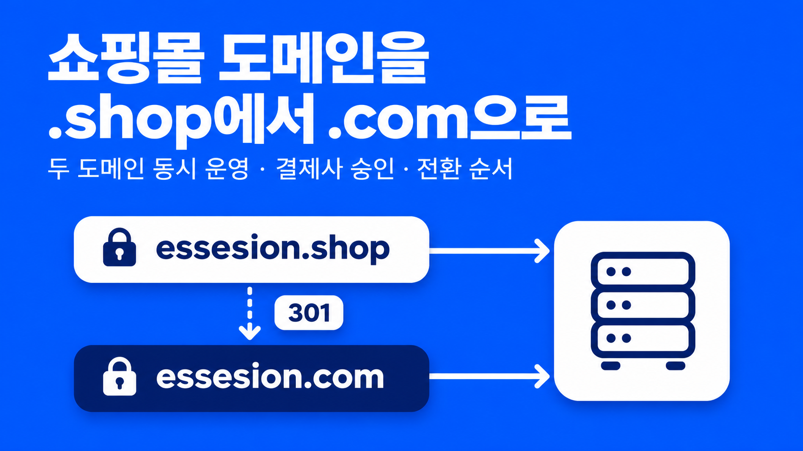
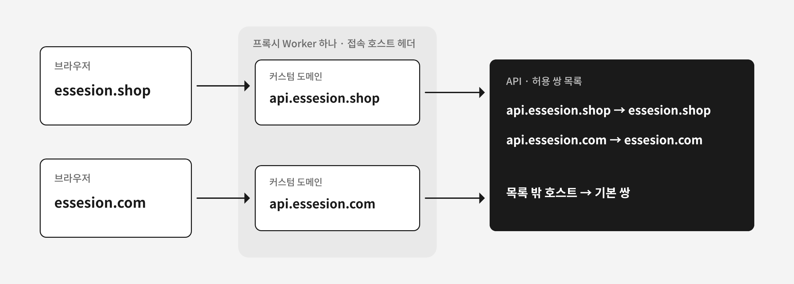
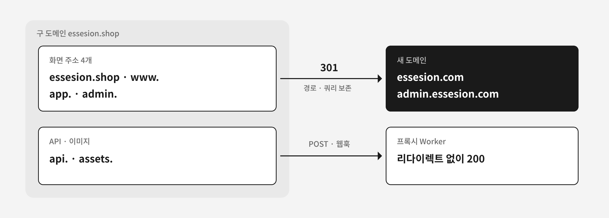

넥타이 맞춤 제작 커머스 essesion의 주소를 `essesion.shop`에서 `essesion.com`으로 옮겼다. 스토어와 관리자 화면은 Cloudflare Workers에, API는 Cloud Run에 있고, API와 이미지는 Cloudflare Worker 프록시(`api.`, `assets.`)를 거친다. 혼자 운영하는 서비스이고 AI 코딩 에이전트와 함께 작업했다.

옮긴 데 기술적 이유는 없었다. 가장 흔한 주소로 가고 싶었고, 사업용 메일 주소를 새로 만드는 시점이라 도메인도 같이 정리했다. 비용 차이도 있었다. `.shop` 1년 연장은 등록 업체 기준 약 7만 원이고 `.com`은 Cloudflare에서 연 1만 원 안팎이다. 그래서 `.shop`은 연장하지 않기로 했다. 만료일은 2026년 12월 12일이었고, 11월 12일에 시작했으니 기한은 한 달이었다.

도메인을 바꾸는 코드는 문자열 치환에 가깝다. 어려운 쪽은 순서였다. 결제사와 소셜 로그인 콘솔이 주소를 등록받고 있어서, 무엇을 먼저 바꾸느냐에 따라 결제나 로그인이 막히는 구간이 생긴다. 이 글은 두 도메인을 함께 운영하다가 전환한 방식과, 단계마다 순서를 그렇게 잡은 이유를 다룬다.

## 도메인에 묶여 있던 것

바꿀 곳을 먼저 셌다. 코드 안보다 밖이 많았다.

| 위치 | 도메인이 들어간 곳 |
|---|---|
| 프론트 | 빌드 시점의 API 주소, 검색 정본 주소, 사이트맵, 구조화 데이터, CSP |
| API | 프론트 주소, OAuth `redirect_uri`, CORS 허용 목록, 알림 문구의 링크 |
| DB | 상품 이미지 등 저장된 절대 URL |
| 인프라 | Worker 커스텀 도메인, 버킷 업로드 CORS, 이미지 변환 허용 소스, 가동 감시 대상 |
| 결제 | 토스페이먼츠 등록 홈페이지 주소, 웹훅 주소 |
| 소셜 로그인 | 카카오·네이버·구글·애플 콘솔의 콜백 주소 |
| 알림톡 | 템플릿 버튼 링크(템플릿마다 검수를 받는다) |
| 검색·분석 | Search Console, 네이버 서치어드바이저, GA4 |

이 가운데 결제사 등록 주소와 알림톡 템플릿은 내가 바꾸는 즉시 반영되지 않는다. 신청하고 승인을 기다려야 한다. 전환 방식은 이 두 가지에 맞춰 정했다.

## 한 번에 바꾸지 않고 동시 운영을 택한 이유

가장 가벼운 방법은 날을 잡아 한 번에 바꾸는 것이다. 인증 코드를 건드릴 필요가 없다. 하지만 토스와 네이버는 새 주소에 사이트가 떠 있어야 주소 변경을 처리한다. 한 번에 바꾸면 등록 주소가 맞지 않는 상태로 전환부터 하고 그다음에 결제를 시험하게 된다. 돈이 오가는 경로에서 그 순서는 받아들일 수 없었다.

그래서 `.com`을 먼저 띄워 `.shop`과 함께 운영했다. 서버를 하나 더 띄운 것은 아니고, 같은 스토어와 API에 주소를 하나 더 붙였다. Cloudflare Worker 하나가 서로 다른 두 존의 커스텀 도메인을 동시에 가질 수 있어서 배포 단위는 그대로였다. 전체 순서는 이랬다.

1. `.com`을 붙여 두 도메인을 함께 운영하고, `.com`에서 소셜 로그인을 시험한다.
2. 토스에 홈페이지 주소 변경을 신청한다.
3. 승인 직후 `.com`에서 실결제 1건을 한다.
4. 결제가 되면 `.shop`을 `.com`으로 리다이렉트한다.

토스가 결제 시점에 등록 주소를 검사하는지는 공개 문서에서 찾지 못했다. 그래서 불리한 쪽으로 가정했다. 승인 전에는 `.com`에서 결제가 안 되고, 승인된 뒤에는 `.shop`에서 결제가 안 될 수 있다고 봤다. 이 가정에서는 승인과 리다이렉트 사이가 결제가 막힐 수 있는 구간이다. 그 구간을 줄이려고 전환용 변경을 전부 PR로 만들어 CI까지 통과시켜 둔 다음에 신청했다.

관리자 화면은 동시 운영하지 않았다. 사용자가 나 하나라 전환하는 날 한 번에 옮겼다.

## 접속한 도메인을 따라가는 로그인: 허용 쌍 목록

동시 운영에서 손이 간 곳은 소셜 로그인이었다. OAuth `redirect_uri`와 로그인 뒤 돌아갈 프론트 주소가 설정값 한 쌍으로 고정돼 있었기 때문이다. `.com`으로 들어온 사용자가 로그인하면 `.shop`으로 돌아가게 된다.



프론트는 접속한 도메인과 같은 도메인의 API를 부르게 했다. 로그인 유지 쿠키가 `SameSite=Lax`라서, `essesion.com` 화면이 `api.essesion.shop`을 부르면 교차 사이트 요청이 되어 쿠키가 실리지 않는다.

```ts
// 단순화한 예
const ON_NEW_DOMAIN =
  typeof window !== "undefined" && window.location.hostname === "essesion.com";

export const API_BASE_URL = ON_NEW_DOMAIN
  ? "https://api.essesion.com"
  : import.meta.env.VITE_API_BASE_URL;
```

API는 요청이 어느 호스트로 들어왔는지 알아야 한다. API 앞의 프록시 Worker가 접속 호스트를 전용 헤더에 덮어써서 넘기고, API는 그 값으로 "API 주소와 프론트 주소" 쌍을 고른다.

```python
# 단순화한 예
def site_pair(self, forwarded_host: str | None) -> tuple[str, str]:
    api_origin = f"https://{forwarded_host}" if forwarded_host else ""
    frontend = self.alt_site_origins.get(api_origin)
    if frontend is not None:
        return api_origin, frontend
    return self.public_api_origin, self.frontend_origin
```

요청의 호스트 값으로 리다이렉트 주소를 직접 조립하지는 않았다. 그렇게 하면 로그인한 사용자를 임의의 도메인으로 보내는 통로가 된다. 허용 목록에 있는 호스트만 자기 쌍을 받고, 목록에 없는 호스트는 기본 쌍으로 처리한다. 전환하는 날에는 기본 쌍과 추가 쌍을 맞바꾸기만 했다. 각 소셜 로그인 콘솔에는 `.shop` 콜백을 둔 채 `.com` 콜백을 추가했다.

로그인 상태를 새 도메인으로 넘겨주는 방법도 있다. 구 도메인이 짧은 수명의 암호화 토큰을 만들어 새 도메인에 넘기고 새 도메인이 쿠키를 다시 심는 방식이다([Transferring Cookies Across Domains](https://www.youssefm.com/posts/transferring-cookies)). 인증 경로에 임시 코드가 하나 더 생기는 데 비해 얻는 것이 작아서 하지 않았다. 방문자가 적고 전부 소셜 로그인이라 다시 로그인하는 부담이 버튼 한 번이다.

## 전환 순서와 순서를 바꾸면 깨지는 것

토스 승인과 `.com` 실결제를 확인한 뒤 11월 19일에 전환했다. 단계마다 앞뒤가 정해져 있었다.

| 단계 | 잡은 순서 | 반대로 하면 |
|---|---|---|
| 운영 환경값과 코드 배포 | 허용 쌍과 CORS 값을 코드 배포보다 먼저 적용 | 실행 중인 API는 모르는 환경값을 무시하므로 먼저 넣어도 해가 없다. 코드가 먼저 나가면 `.com` 화면이 API를 부르지 못한다 |
| 새 이미지 호스트와 DB 주소 변경 | 새 이미지 호스트와 CSP 허용을 별도 PR로 먼저 배포 | 배포 파이프라인에서 DB 마이그레이션이 Cloudflare 배포보다 먼저 실행된다. 한 PR에 넣으면 DB가 아직 없는 호스트를 가리키는 구간이 생긴다 |
| 빌드 변수와 전환 PR | CI 변수의 API 주소를 바꾼 직후에 머지 | 빌드 시점에 굳는 값이라 머지 뒤에 바꾸면 구 주소로 빌드된다 |
| 커스텀 도메인 제거와 리다이렉트 | 리다이렉트 규칙을 꺼진 상태로 미리 만들어 두고, 배포가 커스텀 도메인을 떼면 바로 켬 | 그 사이에는 `.shop`이 응답하지 않는다. 규칙을 그때 만들기 시작하면 이 구간이 길어진다 |
| 302와 301 | 302로 열고 브라우저 실측 뒤 301 | 301은 브라우저가 캐시해서 되돌릴 수 없다 |
| 네이버 로그인의 서비스 URL | 전환한 뒤에 변경 | 사용자가 아직 `.shop`에 있는 동안 대표 주소를 바꾸면 로그인이 제한될 수 있다고 콘솔이 안내한다. 로그인 동작에는 콜백 주소만 맞으면 된다 |

302에서 301로 바꾸는 것은 48시간 뒤로 계획했지만 하루 만인 11월 20일에 바꿨다. `.com`에서 소셜 로그인 4종, 실결제와 취소, 이미지 업로드, 알림톡, 관리자 로그인을 이미 다 확인한 뒤였기 때문이다.

전환 PR을 일주일 열어 둔 대가도 있었다. 그사이 main에 다른 DB 마이그레이션이 같은 부모로 들어와 마이그레이션 헤드가 둘이 됐고, 머지 전에 부모를 옮겼다.

## 리다이렉트는 화면 주소 4개에만

구 도메인의 리다이렉트는 Cloudflare Single Redirect로 호스트마다 하나씩 만들었다. 루트, `www.`, `app.`은 `essesion.com`으로, `admin.`은 `admin.essesion.com`으로 보내고 경로와 쿼리는 보존한다.



존 전체를 와일드카드 한 줄로 넘기지 않은 것은 `api.`와 `assets.` 때문이다. 301과 302는 POST를 GET으로 바꿀 수 있고([Cloudflare Single Redirects 설정 문서](https://developers.cloudflare.com/rules/url-forwarding/single-redirects/settings/)), 웹훅이나 서버 간 호출이 리다이렉트를 따른다는 보장이 없다. 그래서 두 호스트는 리다이렉트하지 않고 구 주소 그대로 응답하게 두었다.

Worker 커스텀 도메인을 뗀 호스트에는 DNS 레코드가 없어서 리다이렉트 규칙이 걸릴 대상이 없다. 프록시를 켠 자리 표시 레코드(`AAAA 100::`)를 만들어 요청이 Cloudflare까지 오게 했다.

## DB에 저장돼 있던 절대 URL

상품 이미지 주소는 저장할 때 절대 URL로 만들어 컬럼에 넣고 있었다. `.shop`이 만료되면 그 이미지는 전부 깨진다. 전환 PR에 데이터 마이그레이션을 넣어 상품 이미지, 상세 이미지, 디자인 템플릿 사진, 팝업 링크의 호스트를 바꿨다.

그것으로 끝나지 않았다. 전환 다음 날 운영 DB의 텍스트·JSON 컬럼 173개를 전부 훑었더니 구 주소가 5행 남아 있었다. 주문 항목에 들어가는 주문 시점의 상품 사본 4행과 문의 답변 1행이었다. 상품 사본에 이미지의 절대 URL이 함께 복사돼 있었다. 마이그레이션을 하나 더 넣어 0행으로 만들었다.

팝업 이미지와 리뷰 이미지는 손댈 것이 없었다. 이쪽은 조회할 때 설정값으로 URL을 만들기 때문에 설정을 바꾸자 따라왔다. 같은 서비스 안에서 저장 시점에 조립한 곳만 마이그레이션 대상이 됐다.

## 코드 밖에서 바꾼 것: 결제 웹훅, 알림톡, 검색 등록, 블로그

토스 웹훅은 수정 기능이 없어서 새 주소를 추가로 등록했다. 기존에 등록된 웹훅은 없어서 지울 것이 없었고, 11월 20일의 부분 취소에서 새 주소로 첫 통지를 받았다.

알림톡은 템플릿 버튼에 주소가 들어가 있어 `.com` 주소로 템플릿을 새로 등록하고 검수를 받았다. 템플릿을 등록한 시점에는 `.com`이 아직 열리지 않아 버튼 링크가 동작하지 않았다. 그래서 등록만 해 두고 검수 요청은 `.com`을 띄운 뒤에 했다. 전환하는 날 8종이 모두 승인된 것을 보고 템플릿 ID를 새것으로 바꿨다. 알림 본문의 링크는 미리 API의 프론트 주소 설정을 따르게 바꿔 두어서 치환할 것이 없었다.

검색 쪽은 301로 바꾼 뒤에 했다. Search Console에 `.com` 속성을 추가하고, `.shop` 속성에서 주소 변경을 제출하고, 새 사이트맵을 냈다. GA4와 Search Console의 연결은 편집할 수 없어서 지우고 새 속성으로 다시 만들었다. 네이버 서치어드바이저에는 `.com`을 새로 등록했다.

설정에서 하나를 놓쳤다. API의 CORS 허용 목록에 새 관리자 화면 주소가 없었다. 업로드용 버킷 CORS만 챙기고 API 쪽을 빠뜨렸는데, 넣지 않으면 새 관리자 화면의 API 호출이 전부 막힌다. 전환하는 날 운영 값을 적용하면서 같이 넣었다.

마지막은 코드에 없는 곳이었다. 네이버 블로그 글 16개 중 12개에 `.shop` 링크가 있어서 고쳐서 다시 발행했다.

## 리다이렉트 3주로 감수한 것

`.shop`을 연장하지 않았으므로 리다이렉트는 전환부터 만료까지 약 3주만 살아 있다. 그 대가는 세 가지다.

- Google은 주소를 바꾼 뒤 리다이렉트를 최소 180일 유지하라고 권한다([Search Console 고객센터의 주소 변경 도구 안내](https://support.google.com/webmasters/answer/9370220?hl=en)). 기간이 짧아 검색 순위가 `.com`으로 다 넘어오지 않을 수 있다.
- 만료 전에 보낸 알림톡과 문자의 `.shop` 링크, 손님의 즐겨찾기는 만료 뒤 열리지 않는다.
- 만료된 도메인은 일정 기간 뒤 누구나 등록할 수 있다. 옛 링크가 남의 사이트로 이어질 수 있다.

`.shop`을 1년 연장하고 리다이렉트를 길게 유지하면 셋 다 피할 수 있다. 연장비가 `.com` 1년 비용의 약 7배라 내지 않고 한 달 안에 끝내기로 했다. 대신 기한 안에 끝나지 않을 것 같으면 다시 따지지 않고 바로 연장하기로 미리 정해 두었다.

방문자는 새 도메인에서 한 번 로그아웃되고, 비회원 장바구니처럼 브라우저에 저장된 상태를 잃는다. 오리진이 바뀌면 브라우저 저장소는 옮길 수 없다.

## 정리: 임시 분기를 지우는 날짜까지 정해 둔 계획

동시 운영은 임시 코드를 운영에 넣는 방식이다. 접속 도메인을 따라가는 프론트 분기, 허용 쌍 목록, CORS와 CSP의 구 주소, 구 `api.` 호스트가 전환 뒤에도 남는다. 계획을 쓸 때 실패하는 경우를 두 가지로 적었다. 이 분기가 정리되지 않고 영구히 남는 것과, 기한을 넘겨 도메인이 만료된 뒤에야 구 호스트에 기대던 것이 드러나는 것이다.

그래서 지우는 날짜를 근거와 함께 정했다. 로그인 유지 토큰의 수명이 14일이다. 301 전환 뒤에는 `.shop` 화면에서 새 세션이 생기지 않으므로 14일이 지나면 구 API 호스트에 묶인 세션은 모두 만료된다. 그보다 먼저 구 호스트를 없애면 탭을 열어 둔 사용자가 조용히 로그아웃된다. 정리는 301 전환 14일 뒤인 12월 4일부터 만료 전날 사이로 잡았고, 끝났는지는 저장소에서 구 도메인 문자열을 검색해 아무것도 나오지 않는 것으로 판정한다.
