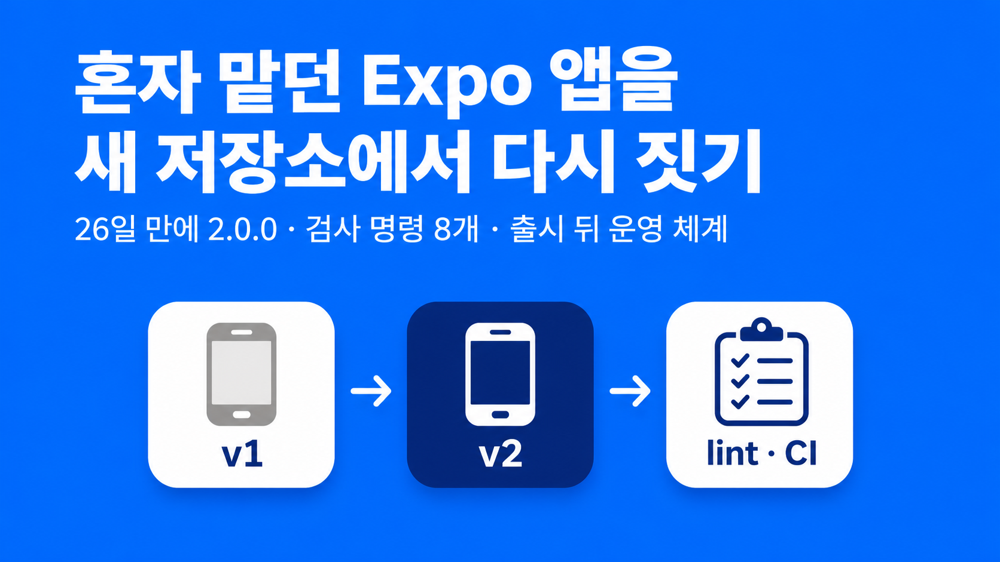
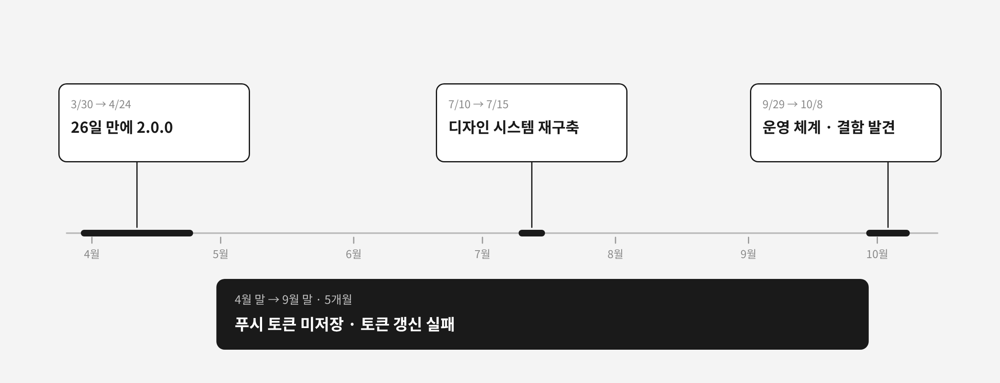
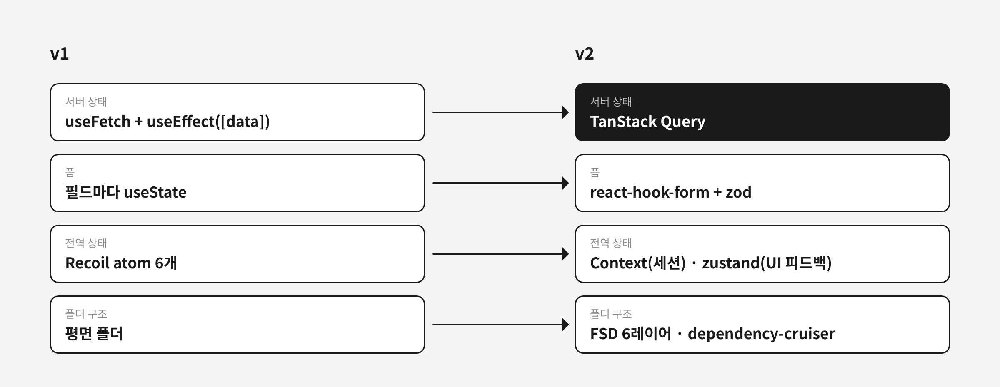
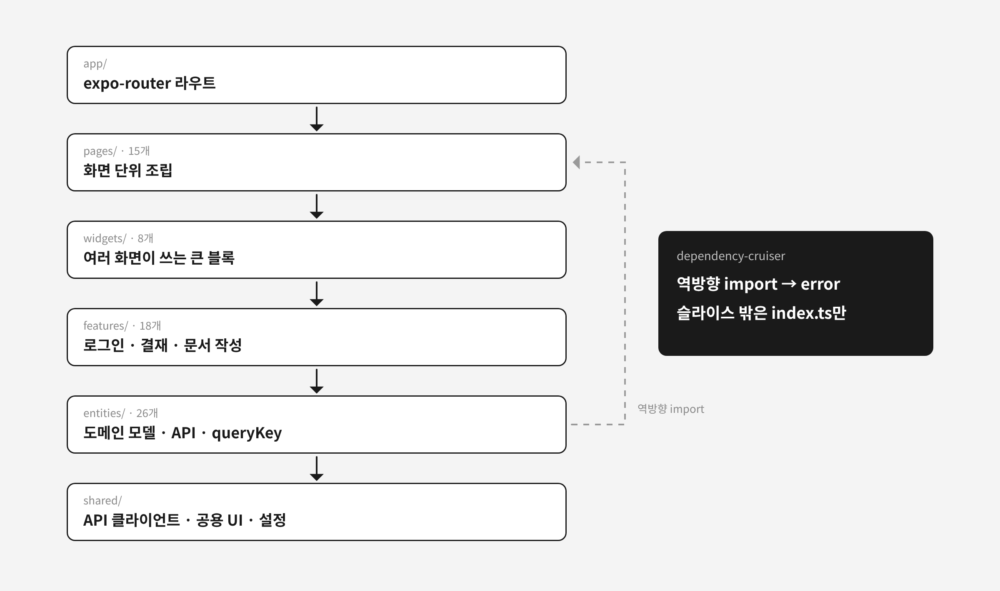

현장 문서와 결재를 다루는 B2B SaaS 모바일 앱이 있다. 일 사용자는 40명에서 100명이다. 2023년 11월 Expo 49로 시작해 2024년까지 여러 명이 개발했고, 2025년 1월부터는 나 혼자 유지했다.

2026년 3월 회사가 디자인 개편을 결정했다. 그 수준의 개편이면 거의 모든 화면 코드를 고쳐야 했다. 나는 이 앱을 새 저장소에서 처음부터 다시 지었다. 3월 30일 첫 커밋을 남기고 26일 뒤인 4월 24일 2.0.0으로 v2 코드를 내보냈다. 스토어 앱은 그대로 두고 버전만 올렸다. 사용자에게는 업데이트 후 디자인이 바뀐 것으로 보였다.

직접 작성한 코드 약 87,500줄에 ESLint·테스트·CI가 없던 앱이었다. 지금 v2에는 검사 명령 8개와 jest 테스트 1,028개가 붙어 있다. 이 글은 새로 짓기로 한 판단, 고른 스택과 규칙, 출시 뒤 드러난 결함과 그 뒤에 만든 운영 체계를 다룬다. 디자인 시스템, 인증 세션, 진입 경로, 빌드 시간, AI 이슈 루틴은 따로 쓴 글에 링크로 넘긴다.

| 항목      | v1                           | v2                                                    |
| --------- | ---------------------------- | ----------------------------------------------------- |
| 기간      | 2023-11부터 2026-04          | 2026-03-30 시작, 26일 만에 2.0.0                      |
| Expo / RN | SDK 54 / RN 0.81             | SDK 55로 시작, 지금은 SDK 57 / RN 0.86                |
| 품질 도구 | main에 ESLint·테스트·CI 없음 | tsc, ESLint 커스텀 규칙, knip, jscpd 등 검사 명령 8개 |
| 테스트    | 없음                         | jest 1,028개                                          |
| 다국어    | 한국어                       | 11개 언어                                             |



## 넘겨받은 v1의 상태

v1의 화면 파일은 API 응답 파싱, 알림, 네비게이션을 전부 맡았다. 자체 훅 `useFetch`를 210개 파일에서 301번 호출했고, 응답은 각 화면의 `useEffect([data])`에서 처리했다. 코드 전체의 `useEffect`가 826개였다.

```tsx
// v1의 전형적인 화면 (단순화한 예)
const { data, fetch } = useFetch<DetailRes>("/document/detail");

useEffect(() => {
  if (!data) return;
  if (data.code !== 200) {
    AlertManager.show(data.message);
    return;
  }
  setForm(data.result);
}, [data]);
```

복사해 붙인 화면도 많았다. 1,600줄이 넘는 상세 화면 두 개는 서로 9줄만 달랐다. 등록 화면과 수정 화면(각 약 610줄)도 9줄 차이였다. 정기와 수시 위험성평가 폴더는 각각 1만 줄 안팎에 구조가 같았다.

| 항목                             | v1                                             | v2                                                         |
| -------------------------------- | ---------------------------------------------- | ---------------------------------------------------------- |
| 알림 방식                        | 자체 `AlertManager` 587회 + `Alert.alert` 92회 | `ui.toast`·`ui.alert`·`ui.confirm`, RN Alert는 lint로 금지 |
| 토큰 재발급 로직                 | 두 곳에 따로                                   | 세션 모듈 한 곳                                            |
| 요청마다 강제 로딩 표시          | 최소 1,000ms                                   | 없음                                                       |
| 인라인 `style={{`                | 2,078회                                        | 디자인 토큰 prop, 하드코딩 색·간격은 lint로 금지           |
| `any` 표기(생성 DTO·테스트 제외) | 427회                                          | 16회                                                       |

react-hook-form은 의존성에만 있고 import하는 파일이 없었다. 폼은 전부 `useState`로 관리했다.

## 새 저장소를 고른 이유: 디자인 개편과 1인 조건

판단 근거는 두 가지였다.

첫째, 디자인 개편으로 거의 모든 화면을 고쳐야 했다. 어차피 전부 손댈 거라면 그때 구조 문제와 코드, 새 도구 세팅을 같이 하는 편이 나았다.

둘째, 이제는 혼자였다. 예전에는 여러 명이 개발했지만 지금은 아니다. lint 규칙이나 경계 검사 같은 도구는 혼자일 때 들이기 좋다고 판단했다. 새 저장소는 기존 위반 0에서 시작하므로, 규칙을 처음부터 error로 켤 수 있었다.

3월에는 v1 저장소 안에서 먼저 손을 댔다. `components/`를 `src/shared/ui`와 `src/features/[domain]`로 옮기고 ESLint를 들여 에러 463개를 고친 브랜치가 있다. 3월 23일에는 같은 저장소의 orphan 브랜치에 새 아키텍처 문서를 썼다. 두 브랜치 모두 main에 머지하지 않았고, 3월 30일 새 저장소를 만들었다. orphan 브랜치의 아키텍처 문서는 v2 첫 아키텍처 문서와 상당 부분 겹친다.

디자인 개편과 코드 재작성을 함께 한 공개 사례는 드물다. 가장 가까운 것은 LINE 데마에칸 배달원 앱으로, 3, 4명이 전체 리디자인과 KMM에서 Flutter로의 재작성을 약 3개월에 했다([LINE Engineering](https://engineering.linecorp.com/ko/blog/demaecan-2nd-recode-kmm-to-flutter)).

## 같은 스토어 앱의 업데이트로 낸 2.0.0

패키지와 스토어 리스팅은 그대로 두고 2.0.0부터 v2 코드를 내보냈다. v2를 만드는 동안 v1에도 결재 기능과 버그 수정을 넣어 4월 16일 1.4.26까지 냈다.

포팅 순서는 이랬다.

1. 3월 30일과 31일: SDK 55 프로젝트, EAS 채널, lint·prettier, AI 에이전트 규칙 문서, FSD 폴더 구조
2. 3월 31일부터 4월 8일: 로그인, 사업장 선택, 인증 이벤트 버스, 탭, 라우트 상수, 중복 로그인 처리
3. 4월 1일부터: 홈, 결재서명, 문서함, 문서 상세 14종, 등록·수정 폼, 위험성평가, 결재 상신, QR, 회원가입
4. 4월 24일: 2.0.0

같은 앱의 업데이트로 냈다는 점은 성공한 재작성 사례들과 같았다. Meta는 iOS Messenger를 다시 쓰고 같은 앱의 업데이트로 수 주에 걸쳐 단계 배포했다([Project LightSpeed](https://engineering.fb.com/2020/03/02/data-infrastructure/messenger/)). 나머지 안전장치는 없었다. 플랫폼을 나눠 내지 않았고, 단계 배포와 롤백 체계도 출시 뒤에 만들었다.

Sonos는 2024년 5월 처음부터 다시 쓴 앱을 모든 사용자에게 한 번에 내보냈다가, 바꾼 기기 탐색 방식 때문에 스피커가 네트워크에서 사라졌다([LeadDev](https://leaddev.com/technical-direction/what-went-wrong-at-sonos)). 내 앱이 그런 장애로 번지지 않은 건 사용자 수가 적어서였다. 새 앱이 옛 앱의 동작을 깨뜨린 결함은 나에게도 있었다. 그 이야기는 뒤의 운영 절에 있다.

## 서버 상태, 폼, 구조를 나눈 스택

v1의 `useFetch`와 `useState`가 하던 일을 성격별로 나눴다.



| 역할         | 선택                   | 이유                                                                                         |
| ------------ | ---------------------- | -------------------------------------------------------------------------------------------- |
| 서버 상태    | TanStack Query         | 캐시·재시도·무효화를 화면에서 걷어 냈다                                                      |
| 세션         | Context API            | 값이 적고 바뀌는 일이 드물어 외부 라이브러리가 필요 없었다                                   |
| UI 피드백    | zustand                | toast·alert를 Promise 대기열로 다뤘고, Context로는 리렌더 범위를 막기 어려웠다               |
| 폼           | react-hook-form + zod  | 필드마다 `useState`를 두던 방식을 없앴다                                                     |
| HTTP         | axios                  | SDK 56부터 전역 `fetch`가 바뀌어 `uri` FormData 업로드가 깨졌다                              |
| API 타입     | openapi-typescript     | DTO를 손으로 고치지 않고 명령 하나로 다시 만들었다                                           |
| 라우팅       | expo-router 단일 Stack | 커스텀 탭 바로 배지·권한별 노출·미저장 이탈 확인을 처리했고, 딥링크 복원과 back이 단순해졌다 |
| 메모이제이션 | React Compiler         | 5월에 켜고 6월에 수동 `useMemo`·`useCallback`을 95개 파일에서 걷어 냈다                      |

Recoil은 2025년 1월 1일 저장소가 아카이브됐다([GitHub](https://github.com/facebookexperimental/Recoil)). v1의 atom 6개는 옮기지 않고 버렸다.

폴더 구조는 FSD를 따랐다. expo-router의 라우트 파일은 `src/app`에 두되, 화면 컴포넌트 하나만 렌더링하게 했다. 로직은 전부 아래 레이어에 있다.



```tsx
// src/app/index.tsx
import { HomePage } from "@pages/home";

export default function HomeScreen() {
  return <HomePage />;
}
```

참조는 `app → pages → widgets → features → entities → shared` 한쪽으로만 흐른다. 이 방향은 dependency-cruiser 규칙으로 막았다.

```js
// .dependency-cruiser.js (일부)
{
  name: "fsd-entities-no-upper-import",
  comment: "entities → features/widgets/pages 참조 금지",
  severity: "error",
  from: { path: "^src/entities/" },
  to: { path: "^src/(features|widgets|pages)/" },
},
```

같은 레이어 안에서 다른 슬라이스를 import하거나, 다른 슬라이스의 `model/`·`api/` 같은 내부 폴더를 직접 import하는 것도 error다. 슬라이스 밖에서는 `index.ts`만 쓸 수 있다.

## 코드 리뷰 대신 검사 명령 8개

리뷰어가 없으니 리뷰가 하던 일을 기계에 맡겼다. 아키텍처 문서에는 "코드 리뷰는 별도 운영하지 않으며, 컨벤션 강제는 lint rule과 CI 게이트로 대체한다"고 적었다.

| 명령                      | 막는 것                   |
| ------------------------- | ------------------------- |
| `npm run typecheck`       | 타입 오류                 |
| `npm run lint`            | 컨벤션, 디자인 토큰 규칙  |
| `npm run check:depcruise` | FSD 레이어 위반           |
| `npm run check:knip`      | 쓰지 않는 export와 의존성 |
| `npm run check:cpd`       | 새로 생긴 중복 코드       |
| `npm run check:i18n`      | 번역 키 누락              |
| `npm run check:tokens`    | 쓰지 않는 디자인 토큰     |
| `npm run generate:types`  | 서버 DTO와 어긋난 타입    |

lastminute.com도 대형 React Native 앱에서 dependency-cruiser로 경계를 강제한다. 이유로 "코드 리뷰는 인간적이고 비동기적이며 일관되지 않다"를 들었다. 다만 한 번에 강제하면 팀 반발로 실패한다고 보고 모듈 단위 opt-in으로 넓혔다([lastminute.com](https://technology.lastminute.com/how-we-enforce-architecture-boundaries-at-scale-on-our-app/)). 나는 기존 위반도, 설득할 팀원도 없었다. 그래서 opt-in 단계 없이 첫날부터 규칙을 켰다.

검사의 1층은 정적 검사이고, 테스트는 그 위에서 버그 시나리오가 있는 로직만 맡았다. 그래서 커버리지 목표 대신 작성 조건을 두었다. 기본값은 "쓰지 않음"이고, 다섯 조건을 모두 통과할 때만 썼다. 버그 시나리오가 있을 것, 정적 검사와 겹치지 않을 것, 구현 세부를 묻지 않을 것, 로직이 있을 것, mock이 3개 이하일 것. 조건을 통과하지 못한 테스트가 코드 수정으로 깨지면 고치지 않고 지웠다. 그렇게 남은 테스트가 지금 1,028개다.

## 디자인 시스템은 두 번 만들었다

외부 UI 킷이 아니라 자체 패키지로 만든 건 토큰 이름과 문구 규칙까지 사내 기준으로 강제해야 했기 때문이다. 첫 디자인 시스템은 화면 포팅과 함께 자랐다. 4월 2일 공용 UI를 패키지로 올렸다. 그런데 토큰이 `textPrimary`, `actionPrimary` 같은 평면 이름 60여 개였다. 그 위에는 "색은 `fg`/`bg`/`stroke` 역할로 고른다" 같은 규칙을 얹을 수 없었다. 5월에 i18n까지 패키지에 넣으면서 패키지가 앱의 번역 네임스페이스에 묶였다.

7월 10일 새 패키지를 처음부터 만들기 시작했고, 7월 15일 레거시를 지웠다. 레거시를 고쳐 쓰지 않은 건 그것을 import하던 277개 파일을 어차피 새 문법으로 다시 써야 했기 때문이다. 이때 지운 코드는 222개 파일, 17,924줄이었다. 레거시를 동결하고 화면 단위로 바꿨으며, 레거시 import 파일 수가 277에서 0이 될 때까지 5일 걸렸다. 토큰 문법과 패키지 경계는 [1부](/posts/dds-m-token-grammar-package-boundary)에, 규칙을 lint와 hook으로 옮긴 과정은 [2부](/posts/dds-m-rules-lint-agents)에 정리했다.

당근 SEED V3도 색을 fg/bg/stroke 역할로 다시 정리했다. 다만 V2와 V3가 한 화면에 섞이지 않게 Foundation부터 점진적으로 바꿨다([How SEED evolved](https://seed-design.io/updates/how-seed-evolved)). 나는 소비자가 앱 하나라 공존 기간 없이 바꿨다. 대신 레거시를 지울 때 그 안의 `StyleSheet.create` 금지 규칙까지 같이 지웠다. 대신할 규칙이 없어서 10월에 lint로 다시 막아야 했다. Shopify Polaris가 v12 토큰을 바꾸면서 codemod와 stylelint를 함께 낸 것도 같은 재발을 막으려는 장치였다([Polaris v11에서 v12로](https://polaris-react.shopify.com/version-guides/migrating-from-v11-to-v12)).

## 출시 5개월 뒤 드러난 결함과 운영 체계

출시 시점의 v2에는 크래시 수집 장치가 없었다. 결함을 알아챌 경로는 고객센터 하나였다. 그 사이 두 결함이 숨어 있었다. 4월 말부터 푸시 토큰이 서버에 저장되지 않았고, 등록 실패는 catch에 묻혔다. 토큰 갱신 요청은 서버 방식과 맞지 않아 한 번도 성공하지 않았다.

두 결함은 크래시가 아니었다. Sentry 같은 크래시 수집 도구가 있었어도 자동으로 잡히지 않았을 유형이다. 푸시 결함은 9월 말 진입 경로 버그를 정리하며 백엔드 코드와 대조하다가 드러났다. 토큰 갱신 결함은 "가끔 로그아웃된다"는 증상을 추적하다가 드러났다. 고친 과정은 [진입 경로 통합](/posts/mobile-entry-navigation-design)과 [세션 규칙](/posts/mobile-auth-session-refresh) 글에 있다.

9월 29일부터 10월 8일 사이에 운영 체계를 만들었다.

| 영역      | 한 일                                                                                               |
| --------- | --------------------------------------------------------------------------------------------------- |
| 관측성    | 스토어 지표(Play, App Store Connect), EAS Observe, 소스맵 자체 보관, 포스트모템 양식                |
| 롤백      | 점진 롤아웃과 롤백 스크립트, 의도적으로 홈을 깨뜨린 OTA로 리허설(복구 1분 48초)                     |
| 사용 기록 | 폰 안에 기록을 남기고 사용자가 `.txt`로 보내는 기능([사용 기록 글](/posts/mobile-user-trail-share)) |
| 빌드      | Android EAS 빌드 28분을 캐시로 13분으로([빌드 시간 글](/posts/eas-android-build-time))              |

이 과정에서 결함을 두 개 더 찾았다. 소스맵 업로드가 계속 실패하고 있었는데, Expo 한도가 5MiB인 데 비해 맵이 21.17MiB였다. 롤백 리허설에서는 첫 화면 렌더 오류가 나면 앱이 스플래시에서 멈추는 결함이 나와 폴백 화면이 스플래시를 직접 내리게 고쳤다.

Expo의 OTA 운영 가이드는 10% 같은 낮은 비율로 롤아웃을 시작하고 외부 크래시 모니터링을 함께 쓰라고 권한다([The production playbook for OTA updates](https://expo.dev/blog/the-production-playbook-for-ota-updates)). 이 가이드에는 롤백 리허설이 없다. 나는 스토어 지표와 EAS Observe로 지표를 보고, 롤백은 실제로 한 번 돌려 보는 쪽을 택했다. Sentry를 직접 호스팅하려면 RAM 16GB와 스왑 16GB가 필요했다.

## AI 에이전트와 혼자 개발하기

3월 31일부터 `AGENTS.md`에 규칙을 두고 `CLAUDE.md`에서 불러왔다. 첫 규칙은 "AI 임의 commit/MR 생성 금지"였다. 계획은 `docs/plans/`에 쓰고, 작업과 점검이 끝나면 지우고 같은 이름으로 `docs/reviews/`에 실제 변경점을 남겼다.

규칙 문서만으로는 부족했다. 디자인 시스템을 점검하면서 "에이전트는 문서를 읽고도 주변 코드의 `useStyles()`를 따라 쓴다"는 걸 알게 됐다. 그래서 기계로 판정할 수 있는 규칙은 lint로 옮겼고, `.tsx`를 편집할 때마다 ESLint를 돌리는 PostToolUse hook을 붙였다. 9월 30일부터는 웹 변경 이슈를 Claude Code 루틴이 받아 MR까지 여는 자동화를 돌렸다. 머지는 사람이 한다([GitLab 이슈 루틴 글](/posts/gitlab-issue-claude-routine)).

대규모 AI 마이그레이션 사례도 판정을 기계에 맡겼다. Google은 JUnit3에서 4로 옮기면서 AST diff와 빌드·테스트 통과를 게이트로 두었다([arXiv 2501.06972](https://arxiv.org/html/2501.06972v1)). Bun은 Zig에서 Rust로 옮긴 코드를 기존 테스트 스위트 100% 통과 뒤에 병합했다([Claude Blog](https://claude.com/blog/ai-code-migration)). 두 사례 모두 옛 코드의 테스트를 기준선으로 삼아 새 코드가 같은 일을 하는지 판정했다. v1에는 그런 테스트가 없었고, lint와 타입 검사로는 "푸시 토큰이 서버에 저장되는가"를 판정할 수 없었다.

## 정리: 혼자 한 재작성의 조건

혼자라는 조건 때문에 위험을 나눠 질 장치가 없었다. 단계 배포, 크래시 수집, 옛 앱과 같은 동작인지 판정하는 기준선 없이 2.0.0을 냈고, 서버와 맞물린 결함 두 개가 5개월 동안 남았다.

같은 조건 덕분에 규칙은 첫날부터 켤 수 있었다. 디자인 개편으로 어차피 모든 화면을 다시 써야 했으니, 새 저장소에서 새 규칙으로 시작하는 추가 비용도 적었다. 지금 이 앱에는 검사 명령 8개, 점진 롤아웃과 롤백 스크립트, 한 번 돌려 본 롤백 리허설이 있다.
