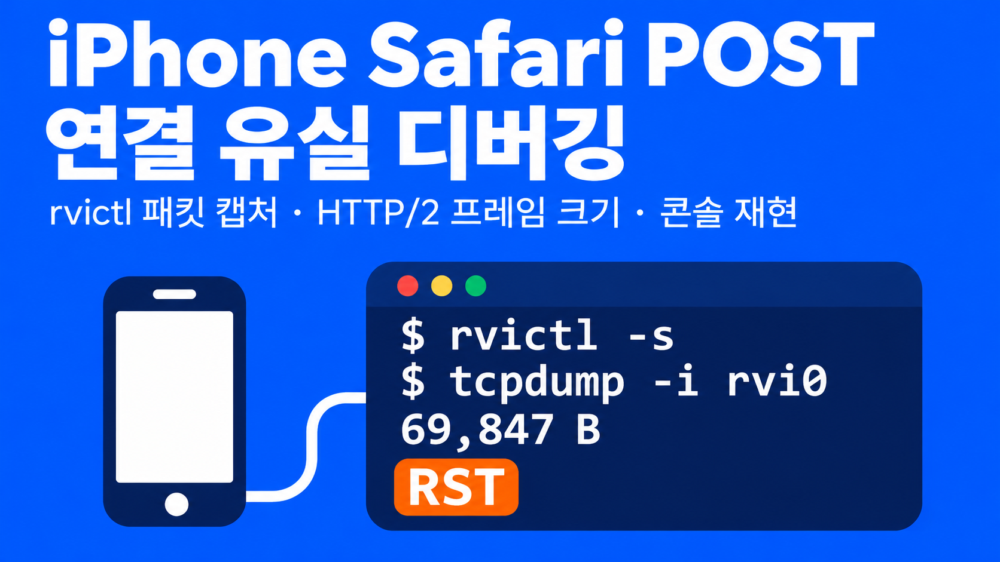
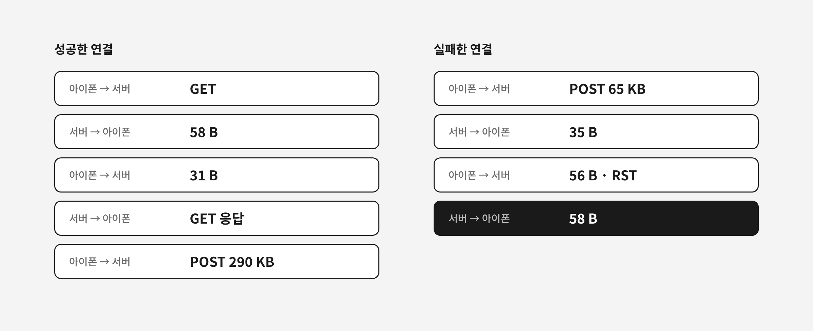

Next.js로 만든 모바일 웹 화면에서 사진을 첨부해 보내는 POST가 iPhone Safari에서만 실패했다. 응답은 없었고, 요청은 0.1초대에 "네트워크 연결이 유실되었습니다"로 끝났다. 데스크톱 브라우저에서는 같은 기능이 문제없이 동작했다.

대상은 고객사 인프라에 있는 개발 서버였다. 응답 헤더는 `server: Apache`였고 브라우저와 서버 사이는 HTTP/2였다. 서버와 앞단 장비는 내가 설정을 보거나 고칠 수 없는 영역이다. 이 글에서 "서버"는 아이폰과 HTTP/2 연결을 맺는 상대편을 가리킨다. 그것이 Apache인지 그 앞의 장비인지는 바깥에서 구분할 수 없었다.

그래서 이 글은 클라이언트 쪽에서 실패 조건을 어디까지 좁혔는지와, 그 조건에 맞춘 우회를 다룬다. 그 조건에서 왜 끊기는지는 확정하지 못했다. 확정하려면 서버 쪽 로그가 필요하다.

좁힌 조건은 이렇다. **새 HTTP/2 연결의 첫 요청이 본문 26,000바이트 이상의 POST이면 실패했고, 24,000바이트 이하이면 통과했다.** 같은 연결에 GET이 먼저 지나가면 300,000바이트도 통과했다. 측정은 iPhone 한 대(iOS 26의 Safari)와 이 서버 하나에서 했다. 추적에는 Safari Web Inspector, `rvictl`, `tcpdump`, Claude Code를 썼다.

## 상태도 프로토콜도 없는 요청: Web Inspector에서 보인 것

iPhone을 Mac에 연결하고 Safari Web Inspector의 네트워크 탭에서 실패한 요청을 봤다.

| 요청 | 프로토콜 | 시간 |
|---|---|---|
| POST (사진 포함), 실패 | 없음 | 135ms |
| GET `/api/auth/session` | h2 | 109ms |
| POST (사진 포함), 성공 | h2 | 7.87초 |

서버가 거절했다면 4xx나 5xx 응답이 있어야 하고, 타임아웃이면 긴 대기가 있어야 한다. 실패한 요청은 둘 다 아니었다. 응답 헤더도 상태 코드도 없이 0.1초대에 끝났다.

프로토콜 칸이 비어 있는 것은 실패 원인의 단서가 아니라 도구의 구조였다. [WebKit 인스펙터 프로토콜 정의](https://raw.githubusercontent.com/WebKit/WebKit/main/Source/JavaScriptCore/inspector/protocol/Network.json)를 보면 프로토콜과 원격 주소는 `loadingFinished` 이벤트의 `metrics`로만 전달되고, `loadingFailed` 이벤트에는 `errorText`와 `canceled`만 있다. 응답 전에 끝난 요청은 어떤 이유로 끝났든 이렇게 보인다. Web Inspector는 HTTP 층까지만 보여 주고, 어느 쪽이 연결을 닫았는지는 알려 주지 않았다.

## 같은 조건이 아니었던 비교 두 개

처음 받은 증상 보고에는 "로컬에서는 촬영해도 정상", "사진첩에서 고르면 정상"이 있었다. 두 비교 모두 조건이 달랐다.

로컬 개발 서버는 http였고, 개발 서버는 https였다. 촬영 버튼은 보안 컨텍스트 여부로 다른 코드를 탔다.

```ts
export const canUseCamera = () =>
  typeof window !== 'undefined' &&
  window.isSecureContext &&
  !!navigator.mediaDevices?.getUserMedia;
```

| 접속 | 촬영 방식 | 페이지 상태 |
|---|---|---|
| 로컬 http | `<input capture>`로 iOS 기본 카메라 앱 호출 | 백그라운드로 내려갔다 돌아옴 |
| 개발 서버 https | `getUserMedia`로 띄운 앱 내 카메라 | 페이지를 떠나지 않음 |

로컬 http에서는 실패하는 경로를 한 번도 타지 않은 것이다. 조건을 맞추려고 자체 서명 인증서로 로컬을 https로 띄웠다. 로컬 https에서는 앱 내 카메라로 찍어 바로 보내도 성공했다. 카메라 코드만으로는 실패하지 않았고, 개발 서버와 겹칠 때만 실패했다.

"사진첩은 정상"은 Chrome에서 본 결과였다. Safari에서는 사진 보관함, 사진 찍기, 파일 선택 모두 실패했다.

## 가설 여섯 개와 그것을 거른 실험

원인 후보는 여러 개가 나왔다. 후보마다 "이 가설이 맞다면 무엇이 관찰돼야 하는가"를 적고, 그 관찰이 나오는지 실험했다.

| 가설 | 맞다면 보여야 할 관찰 | 실험 | 결과 |
|---|---|---|---|
| 서버가 닫은 keep-alive 연결을 재사용했다 | 실패한 뒤 다시 누르면 성공한다 | 페이지를 벗어나지 않고 다시 요청 | 다시 실패 |
| 세션 쿠키가 갱신돼야 한다 | 쿠키를 바꾸지 않는 GET은 효과가 없다 | 콘솔에서 `/api/auth/csrf` GET 뒤 다시 요청 | 성공 |
| 연결이 오래 쉬어서 실패한다 | 카메라 없이 오래 쉰 뒤 보내도 실패한다 | 카메라 없이 약 1분을 기다렸다가 사진 없이 전송 | 성공 |
| 사내 와이파이 망 문제다 | LTE에서는 성공한다 | LTE로 바꿔 요청 | 실패 |
| 앱 내 카메라가 원인이다 | 앨범이나 파일 선택은 성공한다 | Safari에서 세 경로 모두 시도 | 전부 실패 |
| HTTP/3 시도가 실패를 만든다 | 실패가 QUIC(HTTP/3가 쓰는 UDP 기반 전송) 위에서 일어난다 | 패킷 캡처 | QUIC 무응답 0.1초 뒤 TCP로 전환, 실패는 TCP 위 |

첫 번째 가설은 순서가 거꾸로였다. POST를 한 번 더 보내는 수정을 먼저 만들었고, 그 뒤에 수동 재요청이 똑같이 실패하는 것을 보고 되돌렸다. 세 번째 실험은 변수 두 개가 같이 바뀐 실험이었다는 것이 뒤에서 드러난다.

실험에서 남은 사실은 하나였다. 네트워크 목록에서 실패와 성공 사이에는 늘 GET이 있었다.

```
POST ✗ → POST ✗ → POST ✗ → GET session → POST ✓ → POST ✓
```

이 GET은 next-auth가 화면에 포커스가 돌아올 때 보내는 세션 조회다. "다른 창에 갔다 오면 된다"는 보고와 같은 현상이었다. 콘솔에서 쿠키를 건드리지 않는 GET을 보내도 풀렸으니, 세션이 아니라 GET 하나가 지나가는 것 자체가 조건이었다. 왜 그런지는 HTTP 층에서 더 볼 수 없었다.

## rvictl로 아이폰 패킷을 캡처하면

아이폰이 실제로 무엇을 내보내는지 보려고 패킷을 캡처했다. iOS는 기기에서 직접 패킷을 기록할 수 없고, USB로 연결한 Mac에서 원격 가상 인터페이스를 만들어 기록한다. [Apple 문서 Recording a Packet Trace](https://developer.apple.com/documentation/network/recording-a-packet-trace)가 안내하는 방법이다.

```sh
rvictl -s <기기 UDID>                      # rvi0 인터페이스 생성
sudo tcpdump -i rvi0 -n -s 0 -w trace.pcap 'host <서버 IP> or port 53'
```

내용은 TLS로 암호화돼 있어 HTTP 메시지는 보이지 않는다. 보이는 것은 크기, 순서, 방향, 연결의 시작과 종료다. 아래 표의 RST는 TCP 연결을 즉시 끊는 패킷이다. 아이폰에서 동작을 하나씩 하면서 시각을 적어 두고 캡처의 연결과 맞췄다.

| 동작 | 연결의 첫 요청 | 아이폰이 보낸 양 (연결 전체) | 결과 |
|---|---|---|---|
| 앱 내 카메라 촬영 후 전송 | POST | 69,847 B | 0.09초 뒤 아이폰이 RST |
| 홈 화면에 갔다 와서 전송 | GET, 약 1초 뒤 POST | 293,032 B | 성공 |
| 다시 촬영 후 전송 | POST | 69,841 B | 0.1초 뒤 아이폰이 RST |
| 앨범에서 사진 보관함 | POST | 69,846 B | 0.1초 뒤 아이폰이 RST |
| 앨범에서 사진 찍기 | POST | 69,846 B | 0.1초 뒤 아이폰이 RST |
| 앨범에서 파일 선택 | POST | 69,846 B | 0.1초 뒤 아이폰이 RST |

캡처에서 읽은 사실은 네 가지였다.

1. 실패한 요청은 모두 새로 맺은 TCP 연결의 첫 요청이었다. TLS 핸드셰이크는 정상이었다. 닫힌 연결을 재사용한 것이 아니었다.
2. 사진 출처가 달라도 아이폰은 매번 약 69,840바이트를 보내고 멈췄다. TLS 핸드셰이크까지 합친 연결 전체의 양이다. 실패 연결에서 서버가 보낸 양도 매번 4,528바이트로 같았다.
3. 연결을 끊은 쪽은 아이폰이었다. 서버가 35바이트를 보낸 직후 아이폰이 RST를 보냈다.
4. 서버는 마지막 통신 5초 뒤에 연결을 닫았다. [Apache `KeepAliveTimeout`의 기본값](https://httpd.apache.org/docs/2.4/mod/core.html#keepalivetimeout)과 같은 값이다.

4번이 카메라와 앨범을 설명했다. 촬영이나 사진 선택은 5초가 넘게 걸린다. 그 사이 서버가 연결을 닫고, 뒤이은 POST는 새 연결의 첫 요청이 됐다. 카메라는 원인이 아니라 5초 넘게 쉬게 만드는 동작이었다. 다시 눌러도 실패한 것도 같은 이유였다. 재요청 역시 매번 새 연결의 첫 요청이었다.

서버 접근 로그에는 실패 시각의 요청이 없었고, 그래서 요청이 서버에 닿지 않았다고 판단하고 있었다. 캡처에서는 요청 약 68KB가 상대편에 전달됐고 TCP 수신 확인까지 돌아왔다. 접근 로그에 없다는 것이 도달하지 못했다는 뜻은 아니었다.

Web Inspector만 보고 오래 추측하던 문제가 캡처를 시작하고 30분 만에 이 조건까지 나왔다.

## 암호화된 캡처를 프레임 크기로 읽기: 35바이트와 58바이트

이 절에서 얻은 것은 두 가지다. 성공한 연결과 실패한 연결은 메시지의 순서가 달랐고, 서버가 알리는 수신 창은 HTTP/2 기본값보다 작았다.

복호화는 하지 못했다. iOS Safari에서 TLS 키를 받아 낼 방법을 찾지 못했고, 디버깅 프록시를 끼우면 아이폰과 서버 사이의 연결이 둘로 나뉘어 시험하려는 조건이 바뀐다. 대신 크기로 좁혔다. 캡처의 ServerHello에는 TLS 1.3 버전 표시(`supported_versions` 0x0304)가 있었다. [TLS 1.3 레코드](https://www.rfc-editor.org/rfc/rfc8446.html#section-5.2)는 헤더 5바이트, 내부 콘텐츠 타입 1바이트, 인증 태그 16바이트가 붙어 평문보다 22바이트 길다. [HTTP/2 프레임](https://www.rfc-editor.org/rfc/rfc9113.html#section-4.1)은 9바이트 헤더로 시작한다.

| 캡처에서 본 크기 | 평문 크기 | 같은 크기의 HTTP/2 프레임 |
|---|---|---|
| 31 B | 9 B | SETTINGS 확인 응답 |
| 35 B | 13 B | WINDOW_UPDATE 또는 RST_STREAM |
| 58 B | 36 B | SETTINGS(설정 3개, 27 B)와 SETTINGS 확인 응답(9 B) |

SETTINGS는 연결을 시작할 때 양쪽이 주고받는 설정 프레임이다. 58바이트 행은 Mac에서 따로 확인한 값이다. 같은 서버에 HTTP/2 연결을 열고 서버가 처음 보내는 프레임을 읽었더니, 설정 3개짜리 SETTINGS와 SETTINGS 확인 응답이 왔다. 둘을 합치면 36바이트이고 레코드 하나에 실리면 58바이트다.

레코드 하나에 프레임이 여러 개 실릴 수 있어서 이 표는 크기가 같은 후보다. 아이폰이 끊기 직전에 보낸 56바이트와, 핸드셰이크 직후 서버가 보낸 255바이트 두 개는 무엇인지 알아내지 못했다.

이 표를 들고 성공한 연결과 실패한 연결의 순서를 나란히 놓았다.



그림에서는 두 연결에 공통인 TLS 핸드셰이크와 255바이트 두 개를 뺐다. 성공한 연결의 POST 도중에는 서버의 35바이트가 두 번 왔다.

성공한 연결에서는 서버의 58바이트가 먼저 왔고 아이폰이 31바이트로 답한 뒤에 POST가 나갔다. 실패한 연결에서는 아이폰이 요청을 먼저 다 보냈고, 그 뒤 서버에서 온 것은 58바이트가 아니라 35바이트였다. 58바이트는 아이폰이 연결을 끊은 뒤에 도착했다.

실패한 연결 한 건에서 아이폰이 보낸 69,847바이트는 이렇게 나뉜다.

| 구간 | 크기 |
|---|---|
| TLS 핸드셰이크 | 1,636 B |
| 요청 (헤더와 본문, 암호화 포함) | 68,155 B |
| 끊기 직전의 마지막 메시지 | 56 B |

### 서버가 알리는 수신 창: 16,384바이트

HTTP/2에는 흐름 제어 창이 있다. 받는 쪽이 "여기까지 보내도 된다"고 허락한 양이다. Mac에서 읽은 서버의 SETTINGS에는 이 창의 초기값이 들어 있었다.

| 설정 | 값 |
|---|---|
| INITIAL_WINDOW_SIZE | 16,384 |
| MAX_CONCURRENT_STREAMS | 128 |
| ENABLE_CONNECT_PROTOCOL | 1 |

[RFC 9113 3.4절](https://www.rfc-editor.org/rfc/rfc9113.html#section-3.4)은 클라이언트가 서버의 SETTINGS를 기다리지 않고 프레임을 보낼 수 있다고 적는다. SETTINGS를 받기 전의 클라이언트가 아는 창은 기본값 65,535바이트이고, [6.9.2절](https://www.rfc-editor.org/rfc/rfc9113.html#section-6.9.2)은 클라이언트가 연결 직후 60KB를 보내는 경우를 예로 든다. 실패한 연결에서 아이폰이 보낸 요청 68,155바이트는 65,535바이트에 헤더와 TLS 비용을 더한 크기와 맞는다. 크기로 보면 아이폰은 서버의 SETTINGS를 받기 전에 기본 창을 다 채워 보냈고, 서버가 허락하려던 창은 그 4분의 1이었다.

받는 쪽이 이때 무엇을 해야 하는지는 [6.9.3절](https://www.rfc-editor.org/rfc/rfc9113.html#section-6.9.3)에 있다. 창을 줄이려는 수신 측은 그 창을 넘는 데이터를 받을 준비가 돼 있어야 한다. 넘어온 스트림을 계속 처리해도 되고, 흐름 제어 오류로 RST_STREAM을 보내 그 스트림을 끊어도 된다. RST_STREAM은 요청 하나를 취소하는 13바이트 프레임이고, 실패한 연결에서 서버가 보낸 35바이트와 크기가 같다.

GET이 먼저 지나가면 성공하는 것도 같은 틀로 읽힌다. GET을 보낸 아이폰은 서버의 SETTINGS를 받은 상태이고, 그 뒤의 POST는 16,384바이트 창 안에서 서버의 허락을 받아 가며 나간다. 성공한 연결의 POST 도중에 온 35바이트 두 번은 창을 늘려 주는 WINDOW_UPDATE와 크기가 같다.

여기까지가 측정과 규격으로 말할 수 있는 범위다. 실패한 연결의 35바이트가 실제로 RST_STREAM인지는 복호화 없이 확정할 수 없다. 13바이트 프레임은 WINDOW_UPDATE와 RST_STREAM 두 가지이고 크기로는 구분되지 않는다. 3.4절은 서버가 보내는 첫 프레임이 SETTINGS여야 한다고 정하는데, 실패한 연결에서는 35바이트가 58바이트보다 먼저 왔다. 아이폰이 요청 하나가 아니라 연결 전체를 끊은 이유도 캡처로는 알 수 없었다.

Mac의 curl로 같은 서버에 HTTP/2 새 연결의 첫 요청으로 30KB와 300KB를 보냈을 때는 둘 다 도착했다. 서버가 모든 클라이언트의 큰 첫 요청을 막는 것은 아니었다. Safari와 curl이 서버의 SETTINGS를 받기 전에 본문을 얼마나 내보내는지는 비교하지 않았다.

## 앱 코드 없이 콘솔 fetch로 재현: 문턱은 24,000B와 26,000B 사이

이 시점에는 다음 절의 GET 우회가 개발 서버에 배포돼 앱에서는 실패가 재현되지 않았다. 앱 코드를 거치지 않고 서버 동작만 보려고 Web Inspector 콘솔에서 `fetch`로 직접 보냈다. 경로는 존재하지 않는 주소로 했다. 요청이 서버에 도착하면 앱의 오류 응답이 돌아오고, 연결이 끊기면 `fetch`가 예외를 던진다.

```js
(async () => {
  for (const n of [24000, 26000, 30000]) {
    // 서버가 5초 유휴 뒤 연결을 닫으므로 10초를 쉬어 새 연결을 만든다
    await new Promise(r => setTimeout(r, 10000));
    const res = await fetch('/api/__probe__', {
      method: 'POST',
      body: new Uint8Array(n),
    }).then(r => r.status).catch(() => 'FAIL');
    console.log(n, res);
  }
})();
```

본문은 0으로 채운 n바이트다. 바뀌는 변수는 본문 크기 하나였다.

| 조건 | 본문 | 결과 |
|---|---|---|
| 새 연결의 첫 요청 | 300,000 B | 실패 |
| 새 연결의 첫 요청 | 30,000 B | 실패 (3회) |
| 새 연결의 첫 요청 | 28,000 B | 실패 |
| 새 연결의 첫 요청 | 26,000 B | 실패 |
| 새 연결의 첫 요청 | 24,000 B | 도착 (2회) |
| 새 연결의 첫 요청 | 16,385 B, 16,384 B, 16,000 B, 8,000 B, 4,000 B, 1,000 B | 도착 |
| GET 직후 | 300,000 B | 도착 |

대기 루프로 보낸 요청이 전부 도착하는 동안에는 루프 방식이 실패를 재현하는지 알 수 없었다. 그래서 손으로 보냈을 때 실패가 확인된 30,000바이트를 루프에 대조군으로 넣었고, 루프에서도 실패했다.

이 측정으로 가정 두 개를 버렸다. 캡처에서 아이폰이 약 69,840바이트에서 멈췄기 때문에 문턱을 64KB로 보고 있었는데, 30,000바이트도 실패했다. 69,840바이트는 큰 본문이 전송을 멈춘 지점이었고 실패 조건은 아니었다. 다음으로 16,384바이트가 경계일 것으로 봤지만 16,385바이트가 도착했다. HTTP/2의 기본 최대 프레임 크기이자 이 서버가 알리는 수신 창과 같은 값인데, 문턱은 그 값이 아니었다. 24,000바이트와 26,000바이트 사이인 이유는 찾지 못했다.

가설 표의 세 번째 실험은 여기서 다시 읽혔다. 카메라 없이 1분을 쉰 뒤 보낸 요청이 성공해서 유휴 시간을 원인에서 뺐는데, 그 요청에는 사진이 없었다. 유휴 시간과 본문 크기가 같이 바뀐 실험이었다. 문턱 아래의 본문은 새 연결의 첫 요청이어도 통과한다.

조건은 앱 코드, 카메라, 사진과 무관했다. 콘솔에서 보낸 빈 바이트로 재현됐다. 표의 횟수가 측정의 전부이고, 기기 한 대와 서버 하나에서 잰 값이다.

## 우회: 큰 POST 직전의 GET 하나

처음 넣은 우회는 앱 내 카메라의 셔터 직후에 GET을 보내는 것이었다. 캡처에서 이 GET 뒤 2.6초 만에 나간 POST는 같은 연결을 타고 291,157바이트를 전부 보내 성공했다. 하지만 서버가 5초 뒤 연결을 닫으므로, 촬영 후 설명을 입력하느라 5초가 넘으면 효과가 없는 구조였다. 앨범 경로에는 적용되지도 않았다.

그래서 GET의 위치를 사진을 보내는 POST 바로 직전으로 옮겼다.

```ts
// 단순화한 예
const warmUpConnection = () =>
  fetch('/api/auth/csrf').catch(() => undefined);

async function uploadPhoto(form: FormData) {
  await warmUpConnection();
  return fetch('/api/upload', { method: 'POST', body: form });
}
```

GET 응답을 받자마자 POST가 나가므로 둘 사이 간격은 GET 응답 시간인 약 0.1초뿐이다. 업로드마다 그만큼 늦어진다. `/api/auth/csrf`를 고른 것은 Next 서버 안에서 끝나고 백엔드나 세션 쿠키를 건드리지 않는 가벼운 GET이기 때문이다. GET이 실패해도 무시하고 POST를 보낸다.

이 GET은 사진을 보내는 POST 세 곳에 넣었다. 배포한 뒤 앱에서는 실패가 재현되지 않았고, 콘솔에서도 GET 직후에 보낸 300,000바이트는 도착했다. GET과 POST가 같은 연결을 탄다는 것은 페이지 코드로 보장할 수 없다. 브라우저가 연결을 고른다.

POST 재시도가 아니라 GET을 고른 이유는 실험에 있었다. 재시도한 POST도 새 연결의 첫 요청이 되어 똑같이 실패했다. 이 실패에서 Safari가 POST를 알아서 다시 보내지도 않았다. [RFC 9110 9.2.2절](https://www.rfc-editor.org/rfc/rfc9110.html#section-9.2.2)은 멱등이 아닌 요청을 클라이언트가 자동으로 재시도하지 않도록 권고한다.

연결을 미리 여는 요청의 한계는 다른 서비스 문서에도 적혀 있다. [AssemblyAI의 연결 예열 문서](https://www.assemblyai.com/docs/sync-stt/connection-pre-warming.md)는 예열 요청과 본 요청이 같은 연결을 써야 효과가 있고, 유휴로 연결이 닫히면 본 요청이 조용히 새 연결을 연다고 설명한다. 셔터 직후의 GET이 5초 뒤 효과를 잃은 것과 같은 한계다.

이 GET은 임시 처리다. 실패 조건은 그대로 남아 있어서, GET을 넣지 않은 큰 POST는 새 연결의 첫 요청이 되면 같은 방식으로 실패한다.

## 조건의 모양이 같은 공개 사례: nginx 1.9.15와 F5 BIG-IP

같은 증상의 공개 기록을 찾아봤다. 조건이 전부 겹치는 사례는 없었고, 모양이 같은 사례가 두 개 있었다.

| 항목 | nginx 1.9.15 (2016) | F5 BIG-IP (2020) | 이번 사례 |
|---|---|---|---|
| 실패 조건 | SETTINGS 확인 전에 온, 본문 있는 요청 | 첫 요청인 POST가 수신 창을 넘을 때 | 새 연결의 첫 요청이 26,000 B 이상의 POST |
| 크기 문턱 | 없음 | 수신 창 설정값 (기본 32K) | 24,000 B와 26,000 B 사이 |
| 서버의 반응 | REFUSED_STREAM | RST_STREAM | 35 B 메시지 |
| 수정 | 1.11.0의 `http2_body_preread_size` | 16.1.0 | 클라이언트 우회 |

[nginx 티켓 959번](https://trac.nginx.org/nginx/ticket/959)에는 "iOS 9 Safari에서 연결의 첫 요청이 POST이면 실패한다"는 댓글이 있다. [F5 버그 914061번](https://cdn.f5.com/product/bugtracker/ID914061.html)은 제목이 "POST 요청이 첫 요청이고 초기 창 크기를 넘으면 거절할 수 있다"이다. 두 사례 모두 서버나 장비를 고쳐서 끝났다.

F5 사례의 조건은 장비의 수신 창이 64K보다 작게 설정된 것이고, 이번 서버가 알리는 창은 16,384바이트다. nginx가 고친 방식도 같은 방향이다. `http2_body_preread_size`의 기본값 64k는 SETTINGS를 받기 전의 클라이언트가 보낼 수 있는 양을 받아 두는 버퍼다.

이번 사례와 다른 점도 있다. nginx 사례에는 크기 문턱이 없고, F5의 기본값과 이번 서버의 창은 둘 다 측정한 문턱과 맞지 않는다. 두 사례에서는 서버가 스트림을 거절했다. 이번 캡처의 35바이트가 같은 거절인지는 확정하지 못했고, 연결을 끊은 것은 아이폰이었다.

## 정리: HTTP 층에서 안 보이면 패킷부터

비교는 조건을 맞춘 뒤에 근거로 썼어야 했다. "로컬은 된다"는 다른 코드 경로였고 "사진첩은 된다"는 다른 브라우저였다.

연결이 끊기는 문제는 연결을 볼 수 있는 도구로 봐야 했다. Web Inspector에서는 실패한 요청의 상태와 프로토콜이 비어 있었고, 그 빈칸을 해석하는 데 시간을 썼다. 패킷 캡처는 누가 끊었는지, 몇 바이트에서 멈췄는지, 새 연결인지를 바로 보여 줬다. 그 뒤로는 조건을 숫자로 고정하는 일이 남았다.

클라이언트 쪽에서 볼 수 있는 것은 여기까지였다. 실패 조건과 재현 코드, 서버가 알리는 창 16,384바이트까지는 바깥에서 잴 수 있었고, 35바이트가 무엇인지는 서버 쪽 로그가 있어야 확정된다.
