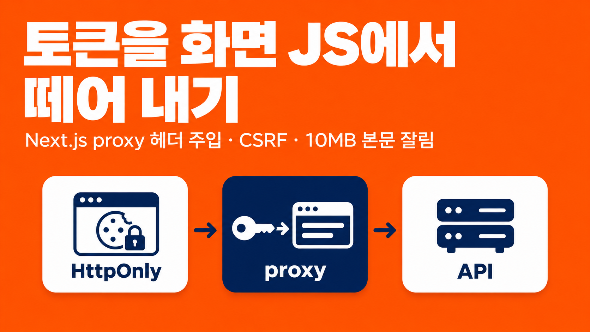
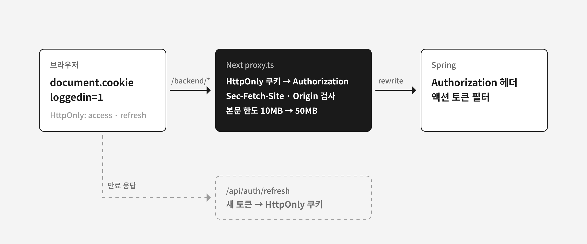

공공기관용 SaaS의 출시 전 검수에서 토큰 쿠키에 HttpOnly·Secure·SameSite가 없다는 결함이 나왔다. access 토큰과 refresh 토큰을 화면 JS가 `document.cookie`로 읽을 수 있었다. 웹앱은 Next.js 16과 next-auth, 백엔드는 Spring이다.

쿠키 옵션 한 줄로 끝나는 일이 아니었다. 화면 코드가 토큰을 직접 읽어 헤더에 붙였고, 쿠키 말고도 토큰이 JS로 넘어가는 길이 여럿 있었다. 이 글은 토큰을 서버만 읽게 바꾼 구조와, 그 구조에서 생긴 함정 세 가지를 어떻게 막았는지 정리한다.

## HttpOnly만 붙이면 깨지거나 새는 곳

| 위치 | 문제 |
|---|---|
| 화면 코드 15곳 | 토큰 쿠키를 직접 읽어 `Authorization` 헤더에 붙인다(공통 요청 함수, 업로드, 에디터, 오류 로그 등) |
| 화면 코드 5곳 | 로그인 여부를 토큰 쿠키가 있는지로 판단한다. HttpOnly로 바꾸면 늘 "로그인 안 됨"이 된다 |
| 토큰 갱신·사업장 전환 | 화면 JS가 토큰을 읽고 새 토큰을 쿠키에 쓴다 |
| 로그아웃 38곳 | JS로 쿠키를 지운다. HttpOnly 쿠키는 JS로 지울 수 없다 |
| `/api/auth/session` | next-auth `session` 콜백이 JWT 전체를 세션에 넣어, 응답에 두 토큰 원문이 담긴다 |
| `/api/auth/token` | 토큰 원문을 돌려주는 API다. 호출하는 곳은 없었다 |
| refresh 토큰 암호화 | 암호화 키가 `NEXT_PUBLIC_` 환경변수라 화면 번들에 실린다 |
| SSE 연결 | 토큰을 주소 뒤 쿼리(`?token=`)로 보낸다 |

아래쪽 세 줄은 쿠키를 HttpOnly로 바꿔도 그대로 남는 누출 경로였다. 관리자 앱도 같은 방식이었다(16개 파일).

## 요청이 모이는 길목: 백엔드 rewrite 경로

화면에서 백엔드로 가는 요청은 업로드와 에디터까지 모두 Next의 rewrite 경로 하나를 거쳤다(이 글에서는 `/backend`로 줄여 쓴다). `next.config.js`의 rewrites가 이 경로를 Spring으로 넘긴다.

Next 16의 `proxy.ts`(이전 이름 middleware)는 rewrites보다 먼저 실행되고, rewrite 대상의 요청 헤더를 바꿀 수 있다. 그래서 토큰을 HttpOnly 쿠키에 두고, `proxy.ts`가 `/backend` 요청마다 쿠키에서 토큰을 꺼내 `Authorization`을 붙이게 했다. 화면 코드 15곳은 헤더를 붙이던 줄만 지우면 됐다.



```ts
// proxy.ts, 단순화한 예
export default async function proxy(req: NextRequest) {
  if (!req.nextUrl.pathname.startsWith('/backend/')) {
    return pageAuth(req); // 화면 경로는 기존 withAuth
  }
  if (req.method !== 'GET' && !isSameOrigin(req)) {
    return new NextResponse(null, { status: 403 });
  }
  const headers = new Headers(req.headers);
  if (req.cookies.has('loggedin')) {
    const token = req.cookies.get('access_token')?.value;
    if (token) headers.set('Authorization', token);
  }
  return NextResponse.next({ request: { headers } });
}
```

`withAuth`는 화면 경로에만 남겼다. 지금 형태 그대로 `/backend`를 matcher에 넣으면 로그인하지 않은 API 호출이 로그인 페이지로 튕기기 때문이다.

## 선택지 A부터 F, 토큰을 어디에 둘까

| 방식 | 판단 |
|---|---|
| A. 서버 전용 쿠키 + `proxy.ts`가 헤더 주입 | 선택. 요청이 이미 한 길목으로 모여 있어 새 프록시가 필요 없었다. [여기어때](https://techblog.gccompany.co.kr/항공-프론트엔드-구축기-8-10-토큰이-세-군데서-온다-b74f5373be70), [IETF 브라우저 앱 OAuth 문서](https://datatracker.ietf.org/doc/draft-ietf-oauth-browser-based-apps/), OWASP, Auth0 모두 토큰은 서버가 들고 브라우저는 모르게 하는 방향이다 |
| B. Route Handler 프록시(`/api/bff/[...path]`)를 새로 만듦 | 기존 rewrite가 하는 일을 코드로 다시 짜야 한다. 업로드 본문을 서버 메모리에 통째로 든다는 보고가 있었고, AI 분석 대기용 `proxyTimeout`(330초)이 적용되지 않는다. A가 헤더 전달 확인에서 실패할 때의 대안으로 남겼다 |
| C. access 토큰은 화면 메모리, refresh 토큰만 HttpOnly | 서버 렌더링이 토큰을 써야 하는데 서버는 화면 메모리를 못 본다. IETF 문서도 메모리 저장으로는 악성 스크립트가 새 토큰을 받아 가는 것을 막지 못한다고 본다 |
| D. Spring이 Set-Cookie로 HttpOnly를 내려줌 | 모바일 앱이 헤더 방식이라 백엔드가 두 방식을 다 받아야 한다. 백엔드 인증 필터, 갱신, 로그아웃을 다시 짜야 한다 |
| E. next-auth 세션 쿠키에 토큰을 넣고 proxy에서 `getToken()` | jwt 콜백에 이미 재귀 무한 루프를 경고하는 주석이 있었고, 같은 구조에서 무한 재발급이 난 사례가 있었다. 출시 전에 손대기엔 위험했다 |
| F. 그대로 두고 CSP 같은 XSS 방어만 강화 | "`document.cookie`로 읽히지 않을 것"이라는 완료 기준을 못 채운다. CSP는 A와 함께 쓸 추가 방어선이다 |

이 작업이 막은 것은 스크립트가 토큰 값을 읽어 가는 경로다. 스크립트 실행 자체를 막는 일은 CSP 같은 다른 방어선의 몫으로 남겼다.

## 자동으로 붙는 헤더와 다시 열리는 CSRF

이전에는 화면 JS가 헤더를 직접 붙였다. 다른 사이트는 이 헤더를 붙일 수 없으니 이 구조가 사실상 CSRF를 막고 있었다. proxy가 쿠키를 보고 헤더를 자동으로 붙이면 이 방어가 사라진다.

백엔드에는 CSRF 성격의 방어가 이미 있었다. 로그인 사용자의 POST·PUT·DELETE는 서버가 발급한 일회용 액션 토큰이 없으면 거부한다. 다만 빈틈이 있었다.

- 업로드, 순서 변경 등 일부 경로는 검사에서 빠져 있다.
- Redis 장애 시 검사 없이 통과한다(fail-open).
- dev·local 프로필에서는 필터 전체가 꺼진다.

그래서 proxy에서 GET이 아닌 요청은 `Sec-Fetch-Site: same-origin`인지 확인하고, 이 헤더가 없으면 `Origin`을 허용 목록과 대조하게 했다. 액션 토큰 필터가 대부분을 막고, proxy 검사는 필터가 빠뜨리는 경로와 Redis 장애 상황을 메운다. 쿠키는 SameSite=Lax로 저장했다. OWASP는 SameSite를 보조 수단으로만 본다.

## 10MB에서 조용히 잘리는 업로드

proxy가 요청을 가로채면 본문을 메모리에 담는다. 사용 중인 Next 16.2.1에서 이 한도의 기본값은 10MB(`proxyClientMaxBodySize: 10485760`)였고, 넘으면 오류 없이 잘라서 넘긴다. 백엔드의 업로드 한도는 50MB라서, 그대로 두면 10MB 넘는 파일이 깨진 채로 저장될 상황이었다.

```js
// next.config.js, 단순화한 예
experimental: {
  proxyClientMaxBodySize: 50 * 1024 * 1024, // 백엔드 업로드 한도 이상
},
```

업로드만 proxy matcher에서 빼는 방법은 쓸 수 없었다. 그러면 업로드 요청에 인증 헤더를 붙일 수 없다.

## HttpOnly인데도 세션 응답으로 새던 토큰

next-auth의 `session` 콜백이 JWT 전체를 `session.user`에 넣고 있었다. 브라우저 JS가 `getSession()`이나 `GET /api/auth/session`을 부르면 access 토큰과 refresh 토큰을 그대로 받는다. 쿠키를 HttpOnly로 바꿔도 이 길로 샌다.

화면에서 `session.user.accessToken`을 쓰는 곳은 없었다. 콜백에서 두 토큰을 빼고 돌려주게 했다.

```ts
// [...nextauth]/route.ts, 단순화한 예
session({ session, token }) {
  const { accessToken, refreshToken, ...user } = token;
  session.user = user;
  return session;
}
```

토큰 원문을 돌려주던 `/api/auth/token`은 사용자 앱과 관리자 앱 모두 호출하는 곳이 없어 통째로 지웠다. 서버가 HttpOnly 쿠키를 읽어 응답으로 돌려주면 HttpOnly로 바꾼 의미가 없다. refresh 토큰의 암호화도 뺐다. 키가 화면 번들에 공개돼 있어 지키는 대상이 없었고, 이제는 HttpOnly가 보호한다.

## 갱신과 로그아웃은 서버 API로

토큰 갱신은 화면 JS가 토큰을 읽고 써야 해서 HttpOnly와 함께 갈 수 없었다. 화면은 토큰 만료 응답을 받으면 Next 서버 API `/api/auth/refresh`를 부른다. 이 API가 쿠키의 두 토큰으로 백엔드 갱신 API를 호출하고, 새 토큰을 HttpOnly 쿠키로만 저장한다. 화면에는 성공 여부만 돌려준다. 사업장 전환도 같은 API에서 처리했다.

로그인 여부는 값 없는 표시 쿠키(`loggedin=1`)로 판단하게 했다. 토큰과 함께 저장하고 함께 지운다. proxy는 이 표시 쿠키가 있을 때만 헤더를 붙인다. 기존 로그아웃 38곳의 JS 쿠키 삭제가 표시 쿠키를 지우므로 그대로 로그아웃이 된다. 서버의 로그아웃 API는 남은 토큰 쿠키도 만료시킨다. 로그아웃 뒤 남은 토큰은 백엔드에서 이미 무효 처리된다.

Secure 속성은 `NEXTAUTH_URL`이 https일 때만 붙였다. 항상 붙이면 사내 IP 같은 http 주소로 개발 서버에 접속할 때 로그인이 깨진다.

## 택하지 않은 방식

| 방식 | 택하지 않은 이유 |
|---|---|
| 갱신을 proxy에서 처리 | rewrite 응답(만료 응답)을 proxy가 볼 수 없다 |
| 갱신 호출만 proxy에 태워 헤더를 붙임 | 백엔드가 새 토큰을 응답 본문으로 주므로 토큰이 다시 JS에 노출된다 |
| 갱신을 Server Action으로 | 쿠키 수정 오류가 보고된 방식이다 |
| 로그인 여부를 `/api/auth/me` 같은 API로 확인 | 화면마다 요청이 하나씩 늘어난다 |
| 공통 쿠키 삭제 함수에서 서버 로그아웃 API 호출 | 로그인 직전에도 쿠키를 지우는 흐름이 있어, 새로 받은 로그인 쿠키를 지울 위험이 있다 |
| SameSite=Strict | QR이나 메일 링크로 들어오는 첫 이동에서 쿠키가 빠진다 |
| SameSite=None | CSRF 위험이 커진다 |
| 이전 쿠키를 읽어 HttpOnly로 다시 심는 호환 구간 | 출시 전이라 한 번 다시 로그인하는 것으로 감수했다. 한 번 쓰고 버릴 코드다 |

## 정리: 쿠키 옵션 한 줄에서 시작한 작업의 범위

HttpOnly 전환은 쿠키 옵션 하나가 아니라 토큰을 읽던 화면 코드 15곳, 세션 응답, 토큰 API, 갱신, 로그아웃을 함께 바꾸는 일이었다. 요청이 이미 rewrite 경로 하나로 모여 있어서 헤더 주입과 CSRF 검사를 그 길목 한 곳에 둘 수 있었다. 길목을 쓰는 대가로 본문 한도와 CSRF를 직접 챙겨야 했다.

## 참고 자료

- [여기어때: 항공 프론트엔드 구축기 8/10, 토큰이 세 군데서 온다](https://techblog.gccompany.co.kr/항공-프론트엔드-구축기-8-10-토큰이-세-군데서-온다-b74f5373be70)
- [IETF: OAuth 2.0 for Browser-Based Applications](https://datatracker.ietf.org/doc/draft-ietf-oauth-browser-based-apps/)
- [OWASP: Cross-Site Request Forgery Prevention Cheat Sheet](https://cheatsheetseries.owasp.org/cheatsheets/Cross-Site_Request_Forgery_Prevention_Cheat_Sheet.html)
