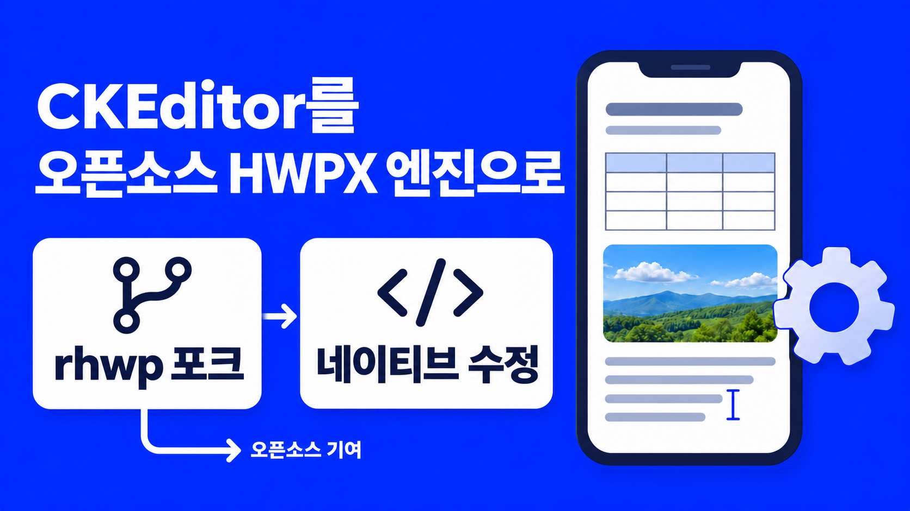
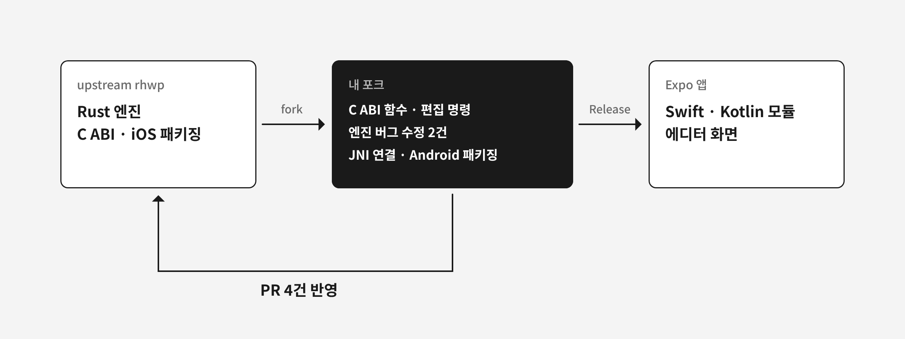
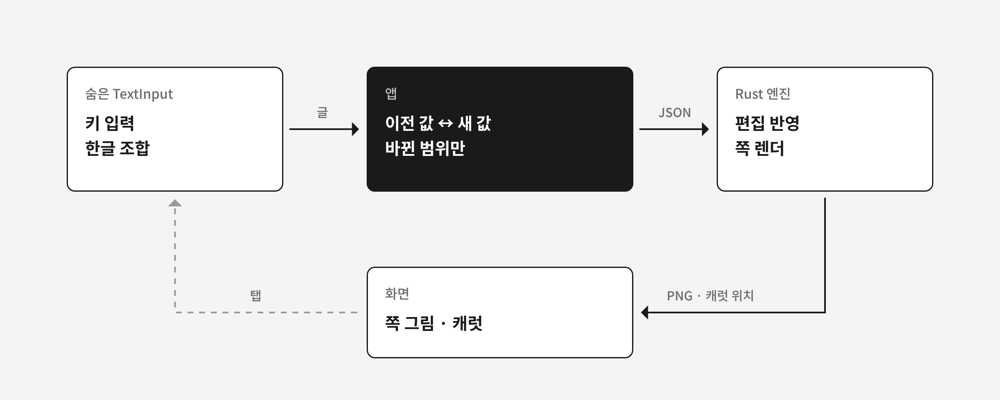

서비스의 문서 본문 에디터는 CKEditor였다. 에디터 안에서 생긴 버그는 대응하기 어려웠고, 모바일 앱에서는 WebView에 에디터를 띄우는 구조라 버벅였다. 그래서 웹과 함께 에디터를 바꾸기로 했다. 기준은 내부 코드를 직접 고칠 수 있는 오픈소스였고, 고른 것이 [rhwp](https://github.com/edwardkim/rhwp)다. rhwp는 Rust로 만든 한글(HWP·HWPX) 뷰어·에디터다.

웹이 먼저 옮겼다. 그 뒤로 서버는 본문을 호환 HTML과 HWPX 두 벌로 저장했고, HTML만 바뀌어 들어오면 HWPX를 버렸다. 모바일 앱에는 HWPX를 다루는 에디터가 없어서, 웹에서 만든 표·사진 본문을 모바일에서 한 번 고치면 HWPX가 사라졌다.

이 글은 모바일 앱에 rhwp를 넣은 과정을 다룬다. rhwp에는 JSON을 주고받는 C ABI와 iOS 패키징, Flutter 참조 에디터가 이미 있었다. 나는 엔진을 포크해 Rust 코드를 고치고 Android용 JNI 연결(C·Kotlin)을 새로 썼다. 앱에는 엔진을 감싼 Expo 로컬 모듈(Swift 145줄, Kotlin 128줄)과 에디터 화면을 만들었다. 제품 기획과 무관한 엔진 결함 4건은 upstream에 이슈와 PR로 올렸고 모두 반영됐다.



## 엔진을 앱 프로세스 안에서

처음 계획은 rhwp의 웹 에디터(rhwp studio)를 WebView에 넣는 것이었다. 편집 UI가 TypeScript 13만 줄이라 엔진만 네이티브로 빌드해서는 UI를 가져갈 수 없다고 봤다. 포크에 좁은 화면용 패치도 7개 만들었다.

이 계획은 하루 만에 접었다. rhwp SDK는 http(s) origin을 요구해서 `file://`로 열 수 없었고, 앱 안에 로컬 서버를 띄우는 안까지 후보로 올라왔다. A4 한 쪽을 폰 폭에 맞추면 글자가 9px로 보였다. 로컬에서 도는 오픈소스를 쓰면서 서버 같은 중간 단계를 거칠 이유가 없었다.

편집 기능(`insertText`, `hitTest`, `getCursorRect`, `exportHwpx` 같은 것)은 전부 Rust 엔진에 있었고, upstream `bindings/Native`가 그 엔진을 C ABI로 열어 두고 있었다. 요청과 응답은 JSON 문자열이다. 그래서 편집 UI만 앱에서 새로 쓰고 엔진은 앱 프로세스 안에서 직접 돌렸다.

에디터 화면은 이렇게 동작한다. 엔진이 쪽을 그림으로 그려 주면 앱은 그 위에 캐럿을 겹쳐 그린다. 키 입력은 화면에 보이지 않는 RN `TextInput`이 받는다. RN `TextInput`은 한글 조합 이벤트를 주지 않으므로 조합은 OS에 맡기고, 앱은 입력란 글의 이전 값과 새 값의 차이만 엔진에 보낸다. 문단 전체를 갈아 끼우면 굵게·색 같은 서식이 하나로 합쳐지기 때문에 바뀐 범위만 교체했다. 이 화면 코드가 2,281줄이다.



## 포크에서 고친 Rust 엔진과 새로 쓴 JNI 연결

upstream 바인딩만으로는 모자랐다. HTML만 있는 옛 본문을 HWPX로 여는 함수가 없었고, 표·사진이 든 문단은 수정도 삭제도 거부됐으며, Android 패키징이 없었다. 포크에 커밋 5개를 쌓았다.

| 커밋 | 내용 | 이유 |
| --- | --- | --- |
| 1 | C ABI에 HTML로 문서 열기, 문단의 표·사진 삭제 명령, 렌더러 글꼴 대체, JNI 연결과 Android 패키징 | 옛 문서 열기, 개체 삭제, Android 지원 |
| 2 | 문단 주소를 받는 편집 명령과 조회 (4파일 +362 −9) | 표 칸 입력, 서식, 표·사진 넣기 |
| 3 | 쪽 설정 조회·변경 | 편집 중에는 쪽 폭을 화면에 맞게 좁히고 저장할 때 되돌린다 |
| 4 | 사진 삽입 직후 "글자처럼 취급"을 켠다 | 삽입 기본값이 종이 기준으로 떠 있는 개체라 사진이 앞 문단 글자를 가렸다 |
| 5 | HTML로 연 문서의 최상위 표를 본문 흐름에 놓는다 | 한 쪽보다 긴 표가 다음 쪽으로 통째로 밀린 뒤 아래가 잘렸다 |

4번과 5번은 에디터를 붙인 뒤에 나온 엔진 버그다. CKEditor에서는 대응하기 어려웠던 종류의 문제를 이번에는 엔진 커밋으로 닫았다.

포크에서는 에디터 코어의 기존 동작을 바꾸지 않고 명령만 더했다. upstream `devel`은 `main`보다 4,227커밋 앞서 있었고 매일 커밋이 들어왔다. 코어를 고치면 리베이스할 때마다 충돌을 떠안는다.

### C ABI 함수 추가: HTML로 문서 열기

HWPX가 없는 옛 문서도 같은 에디터로 열어야 했다. 문서 종류에 따라 화면을 나누면 사용자는 화면이 왜 다른지 알 수 없다. 그런데 세션의 `pasteHtml`은 표가 든 HTML을 거부했다. 이 검사는 그대로 두고, 코어에 이미 있던 HTML 변환을 부르는 C ABI 함수를 하나 추가했다.

```rust
#[no_mangle]
pub unsafe extern "C" fn rhwp_session_open_html(html: *const u8, len: usize) -> *mut c_char {
    response(|| {
        let bytes = unsafe { input(html, len, MAX_DOCUMENT_BYTES)? };
        let html = std::str::from_utf8(bytes)
            .map_err(|_| NativeHostError::InvalidArgument("html is not UTF-8".into()))?;
        HOST.with(|host| {
            // ...
            let session = if html.trim().is_empty() {
                NativeDocumentSession::new_blank()?
            } else {
                NativeDocumentSession::new_from_html(html)?
            };
            // ...
            Ok(json!({"ok":true,"handle":id,"pageCount":page_count,"revision":0}))
        })
    })
}
```

### 표 칸 입력은 주소 지정 명령으로

엔진의 네이티브 에디터는 캐럿과 선택 범위를 거쳐 편집한다. 이 경로는 표 칸 안의 선택을 거부하고, 표·사진이 든 문단의 수정도 거부한다. 차단은 undo·IME·검증에 걸쳐 있어서 포크에서 풀면 upstream을 따라갈 때마다 부담이 된다.

차단은 두고 다른 입구를 냈다. 구역 번호, 문단 번호, 표 칸 위치 같은 주소를 직접 받는 명령이다. `replaceCellText`, `applyCharFormat`, `applyParaFormat`, `insertTable`, `resizeTable`, `insertPicture`를 추가했고, 문단의 표·사진을 되돌리기 한 동작으로 지우는 `deleteParagraphObjects`도 넣었다. 앱은 화면을 누른 자리가 표 칸이면 그 칸의 문단 하나를 입력 대상으로 잡고 이 명령을 부른다.

### Android용 JNI 연결과 정적 링크

upstream에는 iOS 패키징만 있었다. JNI 연결 코드(`rhwp_jni.c` 64줄, `RhwpNative.kt` 28줄)와 패키징 스크립트를 새로 썼다. 엔진 정적 라이브러리와 JNI C 코드를 `librhwp_android.so` 하나로 링크하고 JNI 심볼만 내보낸다. 링커는 JNI가 부르지 않는 C ABI를 버린다.

```bash
"$BIN/$clang$API-clang++" -shared \
  "$out/rhwp_jni.o" "$TARGET_DIR/$target/release/librhwp_native_ffi.a" \
  -Wl,--gc-sections -Wl,--exclude-libs,ALL -Wl,-z,max-page-size=16384 \
  -static-libstdc++ -llog -ldl -lm \
  -o "$out/librhwp_android.so"
```

`max-page-size=16384`는 메모리 페이지가 16KB인 기기를 위한 옵션이다. 기본 빌드는 4KB 정렬이었다. arm64 기준 크기는 52.9MB에서 시작했다. PDF 가져오기 기능을 빼서 36.1MB, 정적 링크로 33.4MB(gzip 14.6MB)까지 줄였다.

Android에서는 한글이 그려지지 않는 문제도 있었다. 엔진이 시스템 글꼴을 찾지 못했고, 시스템 `NotoSansCJK-Regular.ttc`는 엔진의 글꼴 크기 한도(64MiB)에 걸렸다. 앱에 이미 있던 Pretendard를 넘기고, 렌더러가 넘겨받은 글꼴을 마지막 대체 후보로 쓰도록 글꼴 조회 코드를 고쳤다.

## 앱에 붙이는 Swift·Kotlin 모듈

앱에서는 Expo Modules API로 로컬 모듈을 만들어 엔진을 감쌌다. JS에 드러나는 함수는 `open`, `openHtml`, `request`, `requestToFile`, `close` 다섯 개다. `request`는 엔진의 JSON 요청을 그대로 넘긴다.

엔진에는 스레드 제약이 있다. 문서 핸들은 만든 OS 스레드에서만 쓸 수 있다. Expo `AsyncFunction`의 큐는 스레드를 고정하지 않으므로 전용 스레드 하나에서 모든 호출을 돌렸다. Android는 단일 스레드 executor, iOS는 `Thread`다.

```swift
private final class EngineThread: Thread {
  private let condition = NSCondition()
  private var jobs: [() -> Void] = []

  override init() {
    super.init()
    name = "rhwp-engine"
    stackSize = 8 << 20 // 조판 재귀가 깊다. 보조 스레드 기본값(512KB)으로는 모자란다.
    start()
  }
  // ...
}
```

엔진이 그린 쪽(RGBA)은 네이티브에서 PNG로 바꿔 캐시 파일로 내보냈다(iOS `CGImage`, Android `Bitmap.compress`). 화면은 RN `<Image>`로 그 파일을 보여 주므로 그래픽 라이브러리를 새로 넣지 않았다.

엔진 바이너리(XCFramework, `.so`)는 git에 넣지 않았다. 포크의 GitHub Release에 올려 두고, 앱의 `postinstall`이 받아 sha256을 대조한 뒤 모듈 안에 푼다. EAS Build는 git에 없는 파일을 올리지 않아서 손으로 받는 방식으로는 운영 빌드에서 엔진이 빠질 상황이었다. 빌드 서버에 Rust 툴체인을 둘 필요도 없다.

기기에서 잰 엔진 호출 시간은 아래와 같다.

| 기기 | 문서 열기 | 영역 렌더 | 저장 |
| --- | --- | --- | --- |
| Galaxy A34 | 152ms | 약 80ms (1348×720) | 17ms |
| iPhone 17 시뮬레이터 | 31ms | 24ms에서 85ms | |

## upstream에 반영된 PR 4건

포크의 편집 명령, Android 패키징, 쪽 설정은 upstream에 올리지 않았다. 제품 기획에 맞춘 지름길이고, 캐럿과 선택 범위로 편집하는 upstream의 방식과 다르기 때문이다. upstream에는 기획과 무관한 엔진 결함만 올렸다. 넷 다 앱을 만들다 부딪힌 것이다.

| 이슈 → PR | 증상 | 원인과 수정 |
| --- | --- | --- |
| [#8942](https://github.com/edwardkim/rhwp/issues/8942) → [#8982](https://github.com/edwardkim/rhwp/pull/8982) (+86 −1) | HTML의 `<table border="1">`이 선 없는 표가 된다 | 표 파서가 칸의 `border` CSS만 읽었다. 표 태그의 `border` 속성이 0보다 크면 칸 테두리 기본값을 실선으로 둔다 |
| [#8943](https://github.com/edwardkim/rhwp/issues/8943) → [#8983](https://github.com/edwardkim/rhwp/pull/8983) (+102 −0) | 둘째 문단부터 굵은 글자 앞의 보통 글자까지 굵어진다 | 서식 구간 앞의 평문에 글자 모양 구간을 만들지 않았다. 0부터 첫 서식 구간 앞까지 구간을 하나 연다 |
| [#8941](https://github.com/edwardkim/rhwp/issues/8941) → [#9043](https://github.com/edwardkim/rhwp/pull/9043) (+260 −24) | 본문에서 지운 사진이 HWPX 저장 파일에 남는다 | 아래 |
| [#8944](https://github.com/edwardkim/rhwp/issues/8944) → [#9048](https://github.com/edwardkim/rhwp/pull/9048) (+63 −1) | 빈 문단의 캐럿이 가운데·오른쪽 정렬을 따르지 않는다 | 아래 |

앞의 두 건은 HTML만 있는 옛 본문을 HWPX로 열 때 나왔다. 뒤의 두 건은 에디터에서 사진을 지우고 저장할 때, 빈 줄을 가운데 정렬했을 때 나왔다.

### 지운 사진이 저장 파일에 남는 문제는 어떻게 고쳤나

사진 삭제는 본문의 컨트롤만 지우고 문서가 들고 있는 사진 데이터 목록은 그대로 뒀다. HWPX 직렬화기는 그 목록 전부를 `BinData/`에 썼다.

삭제할 때 목록에서도 지우면 간단해 보이지만 그렇게 하지 않았다. 내부 클립보드와 되돌리기 스냅샷이 같은 순번으로 사진을 가리키고 있어서, 삭제 시점에 지우면 잘라낸 사진을 붙이거나 되돌릴 때 다른 사진이 나온다. 그래서 편집 중인 문서는 건드리지 않고 저장용 사본에서만 참조 없는 항목을 버렸다. 정리 함수는 upstream에 이미 있던 것을 재사용했다.

한 가지를 더 걸러야 했다. 저장소의 샘플 HWPX 829개 중 59개는 원본부터 참조 없는 사진 데이터를 지니고 있었다. 저장할 때 일괄로 버리면 손대지 않은 원본의 내용이 바뀐다. 문서를 불러오는 시점에 그런 항목의 id를 기록해 두고 정리에서 제외했다.

메인테이너는 이 구현을 그대로 통합하면서 회귀 테스트 2개(두 차례 저장·재열기 뒤 사진 바이트 보존, 저장 뒤 내부 클립보드 붙여넣기)를 보탰다.

### 빈 문단 캐럿은 한 줄 수정

글자가 없는 문단은 캐럿 위치를 구할 때 별도 분기로 내려간다. 레이아웃은 빈 문단의 문단 끝 위치를 이미 정렬에 맞춰 두었는데, 목록이 아닌 문단의 분기가 그 값을 버리고 줄 왼쪽 끝을 돌려줬다.

```diff
                 } else {
-                    self.line_x
+                    self.first_body_x.unwrap_or(self.line_x)
                 }
```

고치기 전에는 왼쪽·가운데·오른쪽 정렬한 빈 문단의 캐럿 x가 모두 113.4였다. 고친 뒤에는 113.4, 396.9, 680.3이다. 앱에는 이 문제를 피해 가는 보정 코드를 먼저 넣어 두었고, 원인은 upstream에서 고쳤다.

### 통합 PR로 병합하는 저장소

이 저장소의 메인테이너는 여러 PR을 "통합 PR" 하나로 묶어 병합한다. 원 구현을 통합 PR에 옮기고 원 PR은 닫으므로 #9043과 #9048의 GitHub 상태는 `CLOSED`다. 앞의 두 건은 통합 PR #9017, 뒤의 두 건은 #9054로 들어갔다.

이슈를 쓸 때는 재현을 내 포크가 아닌 깨끗한 `origin/devel`에서 했다. 포크에 쌓은 변경이 원인일 수 있기 때문이다. PR 본문에는 수정 전후를 비교한 그림을 붙였다. 전체 테스트가 약 1.3만 건이라 PR 한 건을 검증하는 데 20분에서 25분이 걸렸다.

## 정리: 포크에 둘 것과 upstream에 올릴 것

에디터를 고칠 수 있게 되자 고친 것을 어디에 둘지가 새 문제가 됐다. 기준은 제품 기획에 맞춘 것인지였다. 표 칸 입력 명령이나 쪽 폭 조정처럼 이 앱의 화면에 맞춘 것은 포크에 뒀다. HTML 표의 테두리, 지운 사진의 저장, 빈 문단의 캐럿처럼 누가 써도 걸리는 결함은 upstream에 올렸고 네 건 모두 반영됐다.
