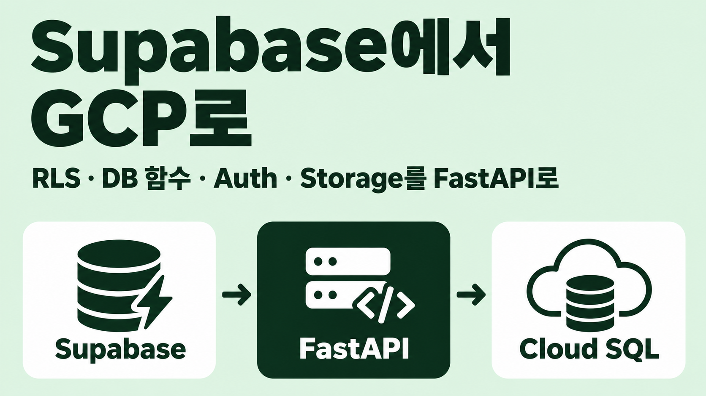
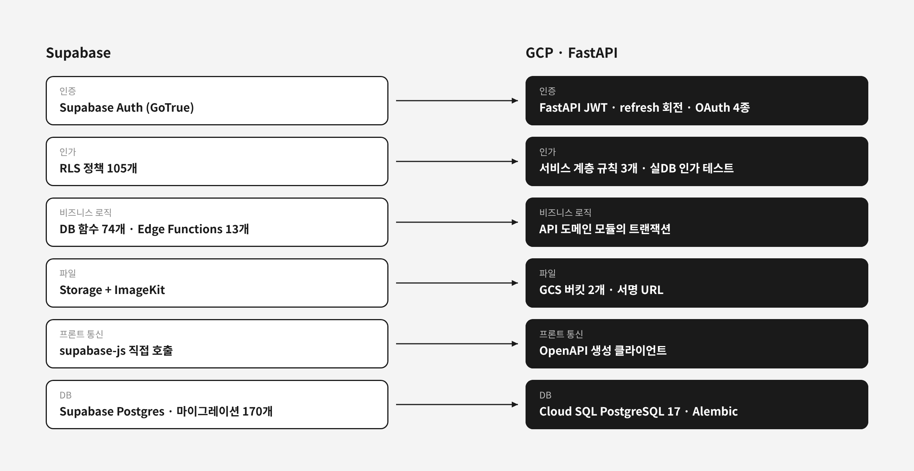
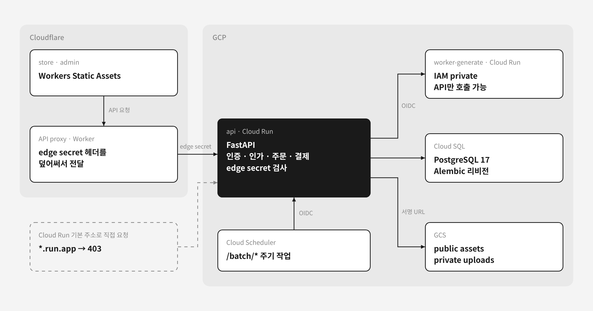

넥타이 맞춤 제작 커머스 YeongSeon은 React 프론트와 Supabase로 만든 서비스였다. 로그인은 Supabase Auth, 권한은 RLS(Row Level Security), 주문·결제 로직은 DB 함수와 Edge Functions, 파일은 Supabase Storage와 ImageKit이 맡았다. 2026년 7월에 이 서비스를 이미지 생성 서비스 seamless-tile과 합쳐 GCP 위에서 처음부터 다시 구현했다. 새 저장소 이름은 essesion이다. 혼자 AI 코딩 에이전트와 함께 작업했다.

옮긴 이유는 두 가지였다. 하나는 Edge Functions의 한계였다. Node.js 기반으로 사진을 편집하는 것 같은 서버 작업을 Edge Functions에서 하기 어려웠다. 다른 하나는 결제였다. 기존 서비스는 실사용자가 거의 없었지만 Toss 결제를 다뤘기 때문에, 돈이 오가는 경로의 규칙을 서버 한곳에 모으고 경계를 먼저 세우고 싶었다.

실사용자가 거의 없었다는 점은 이 글 전체의 전제다. 그래서 기존 데이터를 옮기지 않고 빈 DB로 운영을 시작했고, 스키마도 새로 설계할 수 있었다. 데이터가 많은 서비스의 무중단 이전 노하우를 찾는다면 이 글과는 조건이 다르다.

이 글은 재구현 중 Supabase를 걷어 낸 부분을 다룬다. Supabase가 맡던 기능을 하나씩 무엇으로 바꿨는지, GCP 쪽을 어떻게 구성했는지, 운영 전환 때 어디서 막혔는지를 순서대로 쓴다. 이미지 엔진 재구현은 다루지 않는다.



## 프론트가 DB에 직접 붙어 있던 구조

YeongSeon의 store(고객 앱)와 admin(관리자 앱)은 `supabase-js`로 DB, Auth, Storage에 직접 접근했다. 프론트 코드에서 센 호출 위치는 이랬다.

| 호출 | 위치 수 |
|---|---:|
| `supabase.rpc` (DB 함수 호출, 함수 이름 34종) | 40 |
| `supabase.auth` | 25 |
| `supabase.functions` (Edge Functions) | 8 |
| `supabase.from` (테이블 직접 조회) | 8 |

서버 쪽 규칙은 SQL에 흩어져 있었다. 스키마 파일에 RLS 정책 105개와 함수 74개(트리거 함수 포함)가 있었고, 마이그레이션 파일은 170개였다. Edge Functions는 주문 생성 3종, Toss 결제 확정·취소, 휴대폰 인증, 회원 탈퇴, 만료 이미지 정리 등 13개였다.

규칙이 RLS, DB 함수, Edge Function, 프론트 코드에 나뉘어 있었던 셈이다. 새 구조의 결정 기록에 Supabase를 걷어 낸 이유를 "프론트 직접 DB 결합과 규칙 분산 제거"로 적었다. 그래서 원칙을 둘 세웠다. 프론트는 DB를 모르고 API 클라이언트로만 통신한다. 그리고 기존 코드는 옮기지 않고 새로 쓰되, 각 기능이 "무엇을 하는가"는 보존한다.

API 클라이언트는 손으로 쓰지 않았다. FastAPI가 내는 OpenAPI 스펙에서 Hey API로 fetch SDK와 TanStack Query 옵션을 생성했다. 스펙이 바뀌면 생성물도 같은 커밋에 넣어야 하고, CI가 다시 생성해 보고 차이가 있으면 막는다. 손으로 쓴 DTO와 hook이 서버와 어긋나는 일을 없애려는 장치였다.

보존할 동작의 기준은 매핑 표였다. 기존 테이블, DB 함수, 트리거, Edge Function마다 새 소유자를 한 줄씩 적었다. 재설계가 기능 개편으로 번지지 않게 막는 문서였다.

## RLS 정책 105개를 인가 규칙 세 개로

RLS 정책은 대부분 같은 모양이었다. 주문 테이블을 보면 이렇다.

```sql
CREATE POLICY "Users can view their own orders"
  ON public.orders FOR SELECT
  TO authenticated
  USING ((SELECT auth.uid()) = user_id);

CREATE POLICY "Admins can view all orders"
  ON public.orders FOR SELECT
  TO authenticated
  USING (public.is_admin());
```

정책 105개를 하나씩 옮기지 않았다. 규칙이 단순해서 모델을 먼저 확정했다.

1. 상품·옵션과 좋아요 수는 누구나 조회한다.
2. 그 밖의 리소스(주문, 클레임, 배송지, 문의, 견적, 장바구니 등)는 소유자 본인만 접근한다.
3. 관리자는 별도 로그인(admin 세션)과 역할로 전체에 접근한다.

API에서는 소유자 검사를 함수 하나로 모았다. 행이 없으면 404, 남의 것이면 403이다.

```python
def ensure_owner(row: Any, user: User) -> None:
    if row is None:
        raise NotFoundError()
    if user.role not in ADMIN_ROLES and row.user_id != user.id:
        raise ForbiddenError()
```

RLS는 DB가 강제하지만 서비스 계층 인가는 코드가 빠뜨리면 그만이다. 그래서 인가 테스트를 행렬로 만들었다. 엔드포인트를 케이스로 등록하면 같은 검사를 한꺼번에 돌린다. 아래는 요청 부분을 줄인 단순화한 예다.

```python
OWNER_CASES = [
    OwnerCase("orders_detail", "GET", _order_detail),
    OwnerCase("claims_delete", "DELETE", _claim_delete),
    OwnerCase("inquiries_update", "PATCH", _inquiry_update),
    # ...
]

@pytest.mark.parametrize("case", OWNER_CASES, ids=lambda c: c.name)
async def test_owner_only_resource(case, client, db_session, settings):
    owner = await make_user(db_session, name="소유자")
    other = await make_user(db_session, name="타인")
    admin = await make_admin(db_session)
    url, body = await case.make(db_session, owner)  # 소유자의 실제 행을 만든다

    assert (await client.request(case.method, url, json=body)).status_code == 401
    assert (await req(other)).status_code == 403
    assert (await req(owner)).status_code not in (401, 403)
    assert (await req(admin)).status_code == 401  # admin 세션은 store 경로와 분리
```

소유자 전용 케이스 12개와 관리자 전용 케이스 15개를 등록했다. 관리자 전용 쪽은 익명이 401, 일반 고객이 403인지 검사한다. 이 테스트는 mock 없이 testcontainers로 띄운 실제 PostgreSQL에서 돈다. 인가는 mock으로 검증하면 안 되는 영역이라고 판단했다.

## DB 함수와 트리거는 API 트랜잭션으로

새 스키마에는 DB 함수, 비즈니스 트리거, 애플리케이션 뷰를 두지 않았다. 채번, 토큰 원장, 인가, 통계를 모두 API가 가진다. 스키마의 정본은 SQLAlchemy 모델이고, 변경은 Alembic 리비전으로만 한다. CI에서 `alembic check`로 모델과 리비전이 어긋나는지 검사한다.

주문 번호 채번이 예다. 기존에는 plpgsql 함수가 날짜별 advisory lock을 잡고 그날의 최댓값에 1을 더했다.

```sql
perform pg_advisory_xact_lock(hashtext(date_str));
select coalesce(max(cast(substring(order_number from 14) as integer)), 0) + 1
  into seq_num
  from orders
 where order_number like 'ORD-' || date_str || '-%';
```

API로 옮기면서 같은 방식을 그대로 재현했다. 날짜도 기존 함수처럼 DB의 `now()`를 기준으로 했다. 동작 보존이 원칙이었기 때문이다. 다만 잠금 순서를 정했다. API는 사용자 리소스를 바꾸기 전에 사용자 단위 advisory lock(`user:{id}`)을 잡는데, 이 잠금을 먼저 잡고 채번 잠금은 나중에 잡게 해 데드락을 피했다. 경합이 남으면 unique 제약이 마지막으로 막는다.

```python
async def generate_number(session, column, prefix: str) -> str:
    date_str = await session.scalar(select(func.to_char(func.now(), "YYYYMMDD")))
    await advisory_xact_lock(session, f"num:{prefix}:{date_str}")
    max_seq = await session.scalar(
        select(func.max(func.split_part(column, "-", 3).cast(Integer)))
        .where(column.like(f"{prefix}-{date_str}-%"))
    )
    return f"{prefix}-{date_str}-{(max_seq or 0) + 1:03d}"
```

옮기면서 없앤 것도 있다. `updated_at` 트리거 17종은 SQLAlchemy `onupdate`로 바꿨다. 모든 쓰기가 API를 거친다는 전제다. 찜 수를 세던 집계 테이블과 트리거는 지우고 목록 쿼리의 `COUNT`로 대신했다. 사용자 수가 적어 집계 테이블이 필요 없었다. 뷰 19개도 API 조회 쿼리로 옮겼다.

## Auth: 비밀번호 해시 없이 전원 재로그인

기존 사용자는 전원 소셜 로그인이었고 수도 아주 적었다. 그래서 비밀번호 해시는 옮기지 않았고, 운영 전환 때 기존 세션도 넘기지 않고 전원 재로그인하기로 했다.

새 인증은 FastAPI가 직접 발급하는 JWT다. access 토큰은 짧게 두고, refresh 토큰은 불투명 난수로 만들어 DB에는 SHA-256 해시만 저장했다. refresh 토큰은 쓸 때마다 회전한다. 이미 쓴 토큰이 다시 오면 같은 사용자의 같은 세션 종류(store 또는 admin) 토큰을 모두 폐기한다.

소셜 로그인은 Authlib으로 Google, Kakao, Naver, Apple 4종을 붙였다. Google과 Kakao는 기존에 쓰던 것이고 Naver와 Apple은 새로 더했다. Apple은 `.p8` 키로 서명한 ES256 client_secret JWT를 써야 하고 콜백이 `response_mode=form_post`라 다른 사이트에서 POST로 들어온다. 그래서 Authlib이 OAuth state를 담는 세션 쿠키만 비로컬 환경에서 `SameSite=None`으로 뒀다. 로그인 쿠키는 `SameSite=Lax`다.

Supabase의 `auth.users`와 `profiles`는 `users` 테이블 하나로 합쳤다. `users.email`은 nullable에 부분 unique다. 카카오는 이메일 제공에 동의하지 않아도 로그인할 수 있기 때문이다. 공개 회원가입은 없고, Argon2id 비밀번호 계정은 로컬 시드와 운영자 계정에만 쓴다.

## Storage와 ImageKit 자리에 GCS 버킷 두 개

업로드는 ImageKit을 빼고 API가 발급하는 GCS 서명 URL로 바꿨다. 프론트에서 `@imagekit/react` 의존이 사라졌고 업로드 인증용 Edge Function도 없어졌다. 기존 이미지는 양이 적어서 자동으로 옮기지 않고 운영자가 다시 등록하기로 했다.

처음 계획은 assets 버킷 하나였다. 그런데 고객 업로드가 공개 버킷에 섞여 URL만 알면 열렸다. 구현 3일째에 비공개 uploads 버킷을 따로 만들고 IAM을 나눴다. 공개 결과물과 고객 첨부의 경계를 버킷 단위로 나눴다. 비공개 버킷에는 공개 조회 권한이 없고, API가 짧은 서명 URL을 발급한 뒤 업로드가 끝나면 크기, 형식, 소유권, 실제 객체를 검증한다.

## GCP 구성: Cloud Run 앞에 Cloudflare proxy

최종 구성은 이렇다.



Supabase가 한 프로젝트 안에서 알아서 해 주던 경계를 하나씩 직접 세워야 했다. 정리하면 아래와 같다.

| 경계 | 방식 |
|---|---|
| 브라우저 → API | Cloudflare proxy가 덮어쓰는 edge secret이 정확히 하나 맞아야 통과 |
| API → worker | Google OIDC audience와 service account IAM |
| Cloud Scheduler → 배치 | audience와 호출 service account email을 함께 검증 |
| GitHub Actions → GCP | Workload Identity Federation, 장기 key 없음 |
| 런타임 → 비밀값 | 서비스별 Secret Manager IAM |

API를 Cloudflare 뒤에 둔 것은 WAF와 봇 차단을 코드 없이 얻고 도메인과 인증서를 한곳에서 관리하기 위해서였다. 문제는 Cloud Run이 `run.app` 주소를 따로 열어 둔다는 점이다. 그 주소로 직접 오면 Cloudflare를 건너뛴다. 그래서 API 미들웨어가 edge secret 헤더를 검사해, 없거나 둘 이상이거나 값이 다르면 403을 돌려준다. 예외는 liveness용 `/healthz`와 OIDC로 따로 검증하는 `/batch/*`뿐이다.

pg_cron과 Edge Function으로 돌던 주기 작업(오래된 결제 대기 주문 취소, 배송 완료 주문 자동 구매 확정, 만료 이미지 정리)은 Cloud Scheduler가 API의 `/batch/*`를 OIDC 토큰과 함께 호출하는 방식으로 바꿨다. audience 값이 어긋나면 배치 전체가 조용히 401로 실패하기 때문에, 운영 문서에 개통 때 audience를 반드시 대조하라고 적었다.

DB 연결은 처음에 `cloud-sql-python-connector`를 쓸 계획이었다. 실제로는 Cloud Run에 Cloud SQL 볼륨을 `/cloudsql`로 마운트하고 asyncpg가 Unix 소켓으로 접속하게 했다. Cloud Run에서는 이쪽이 더 단순했고 커넥터 라이브러리가 필요 없었다.

비로컬 환경은 설정이 빠졌을 때 조용히 대체 동작으로 넘어가지 않게 했다. GCS 설정이 없으면 기동을 멈추고, 결제나 문자 같은 외부 연동 설정이 없으면 `/readyz`가 503을 내거나 해당 요청을 막는다. 로컬에서만 결제·문자 DryRun과 개발용 토큰을 허용한다.

리소스는 전부 OpenTofu로 선언했다. 프론트는 Cloudflare Pages가 아니라 Workers Static Assets로 배포했다. Cloudflare가 Pages를 유지보수 모드로 두고 새 프로젝트에는 Workers를 권장하고 있었기 때문이다([Cloudflare Workers Static Assets 문서](https://developers.cloudflare.com/workers/static-assets/)).

## 데이터 변환 이관은 접고 빈 DB에서 시작

처음 계획은 변환 이관이었다. 상품, 옵션, 쿠폰, 단가, 모티프처럼 사용자와 무관한 데이터는 기존 스키마에서 새 스키마로 바꿔 옮기는 스크립트를 짰다. 주문 같은 사용자 종속 데이터는 재로그인 때 기존 사용자와 연결할 수 있으면 옮기고, 아니면 포기하기로 했다.

구현 중에 이 경로를 접었다. 7월 23일에 개발 중 쌓인 Alembic 리비전을 단일 베이스라인 하나로 합치면서 변환 스크립트도 지웠다. 운영 DB는 빈 Cloud SQL에 베이스라인을 적용하고 관리자 계정, 공개 모티프, 디자인 예시를 시드로 넣는 방식으로 바꿨다. 매핑 표는 실행할 이관 계약이 아니라 기존 도메인 의미를 검토한 설계 기록으로 남았다.

빈 DB에서 시작하니 다른 곳이 막혔다. 운영 DB를 부트스트랩하고 보니 `admin_settings`와 `pricing_constants`가 둘 다 0행이었다. 관리자 화면의 설정·가격 편집은 기존 행을 나열해 고치는 구조라 없는 키를 새로 만들 수 없었다. 로컬 시드 스크립트는 운영 환경에서 실행을 막아 뒀고, 마이그레이션에도 초기 행을 넣는 부분이 없었다. 가격 키 40개를 채울 수단이 없었고, 하나라도 비면 가격 계산이 `pricing_not_configured`로 실패했다.

운영자용 부트스트랩 스크립트에 `seed-config` 서브커맨드를 더해 해결했다. 기본값은 로컬 시드와 같은 파일 하나에서 가져오고, 덮어쓰기 동작만 호출자별로 나눴다.

| 호출자 | 동작 |
|---|---|
| 로컬 `seed.py` | 덮어쓴다. 단가만 옛 값에 남으면 플랜 수량과 어긋난다 |
| 운영 `seed-config` | 빠진 행만 채운다. 운영자가 화면에서 조정한 값은 재실행해도 되돌리지 않는다 |

## 컷오버에서 걸린 외부 콘솔과 환경변수

코드 밖의 설정은 DNS를 되돌려도 원래대로 돌아오지 않는다. 운영 전환 체크리스트를 대조하다 OAuth와 Toss 웹훅을 문서마다 한 문장에 묶어 다루고 있는 것을 발견했다. 둘은 성격이 반대였다.

| 설정 | 바꾸는 방식 | 영향 |
|---|---|---|
| OAuth redirect URI | 콘솔에 새 주소를 추가 | 기존 등록과 함께 쓸 수 있다 |
| Toss 웹훅 URL | 보통 상점당 하나라 교체 | 같은 상점을 쓰는 다른 서비스의 통지가 끊긴다 |

이번에는 기존 YeongSeon에 실사용이 없어서 웹훅 교체에 위험이 없었다. 그래도 롤백 절차에 "외부 콘솔 설정은 DNS 원복으로 되돌아가지 않는다"를 적어 뒀다. 등록 시점도 문서끼리 어긋나 있었다. 공개 회원가입이 없어 소셜 로그인이 유일한 가입 경로였으므로, redirect URI는 컷오버가 아니라 배포 직후에 등록해야 했다. 등록 전에는 새 store에 아무도 로그인할 수 없다.

환경변수에서도 하나가 빠졌다. 문자 발송 업체 Solapi의 템플릿 ID 두 개가 Cloud Run 환경변수에 없었다. `/readyz`는 Solapi 키 7개만 확인했는데 이 두 개는 그 목록에 없었다. 그래서 상태 검사는 정상인데 인증번호는 알림톡 대신 평문 SMS로 나가고, 결제 완료 알림톡은 로그도 없이 발송되지 않았다. 두 키를 OpenTofu 변수 예시에 경고와 함께 추가했다.

## 다른 팀은 왜 Supabase를 떠났나

Supabase에서 자체 백엔드로 옮긴 사례를 찾아봤다. 직접 옮긴 사람이 쓴 글과 토론 위주로 추렸다.

| 출처 | 떠난 이유 | 옮긴 곳 |
|---|---|---|
| [Val Town: Migrating from Supabase](https://blog.val.town/migrating-from-supabase) (2023) | 로컬 개발이 안 돼 운영 DB에서 스키마를 직접 바꿨다. 야간 백업 때 DB가 멈췄고, RLS로 컬럼 단위 접근을 막을 방법이 없었다 | Render의 관리형 Postgres. 트리거·저장 프로시저·RLS는 애플리케이션 코드로 |
| [Hacker News: Migrating from Supabase](https://news.ycombinator.com/item?id=36004925) (2023) | DB 함수에 로직을 쓰기 싫어 API 서버로 돌아갔다는 경험담 | Prisma를 쓰는 Node 백엔드 |
| [Hacker News: Supabase 시리즈 D 토론](https://news.ycombinator.com/item?id=43763445) (2025) | DB 밖 흐름을 트리거로 옮기다 보니 비즈니스 로직 대부분이 SQL에 갇혔다 | 일반 엔드포인트, Deno 백엔드 |

DB를 단순한 저장 계층으로 두고 로직을 애플리케이션으로 옮긴 방향은 내 결정과 같았다. 프론트에서 DB를 뗀 근거는 달랐다. 나는 결합과 규칙 분산을 이유로 들었는데, [DeepStrike의 조사](https://deepstrike.io/blog/hacking-thousands-of-misconfigured-supabase-instances-at-scale)는 같은 구조를 노출 위험으로 본다. 브라우저가 DB API를 직접 부르면 RLS를 한 테이블만 빠뜨려도 공개 키로 그 테이블을 읽을 수 있다. 이 글이 인용한 UpGuard 조사에서는 Supabase를 쓰는 도메인 약 300,000개 중 16,326개의 DB가 읽을 수 있는 테이블을 노출하고 있었다.

| 항목 | 다른 팀 | 나 | 대가 |
|---|---|---|---|
| 스키마 | 그대로 두고 데이터만 옮겼다. Val Town은 40GB를 `pg_restore` 10분, 이전 전체 약 1주 | 재설계 | 옮길 데이터가 거의 없어서 가능했다. 데이터가 많은 서비스라면 스키마를 유지한 채 호스트부터 옮기는 편이 현실적이다 |
| Auth | Val Town은 Clerk 같은 관리형 | FastAPI 자체 JWT | refresh 회전과 재사용 감지, Apple 콜백 쿠키를 직접 다뤘다 |
| 인가 | RLS 대신 애플리케이션 코드 | 서비스 계층 규칙 3개 | DB가 보장하던 최저선이 없어져 실DB 인가 행렬 테스트로 채웠다 |

Supabase를 DB와 Auth로 남기고 앞에 백엔드만 세우는 방법도 있다([Paralect](https://www.paralect.com/stack/dont-use-rls-in-supabase)가 권하는 방식). 이전 비용은 가장 적지만 Supabase 의존과 Edge Functions의 한계가 남는다. 이 프로젝트는 그 한계가 옮긴 이유였다.

## 택하지 않은 방식

| 방식 | 택하지 않은 이유 |
|---|---|
| 스트랭글러 방식의 점진 이전 | 프론트, API, 스키마를 전부 새로 쓰는 작업이라 기존 시스템과 섞어 운영할 수 없었다. 병행 구축 후 한 번에 전환했다 |
| RLS 정책 전수 이식 | 규칙이 소유자·공개·관리자 세 가지로 정리됐다. 모델을 먼저 확정하고 실DB 인가 테스트로 검증했다 |
| 비밀번호 해시·세션 이관 | 기존 사용자가 전원 소셜 로그인이고 수가 적었다 |
| Storage 객체 자동 이관 | 이미지가 적어 운영자가 다시 등록하기로 했다 |
| ImageKit 유지 | GCS 서명 URL로 업로드를 대신할 수 있어 외부 의존을 하나 줄였다 |
| LangGraph checkpoint 테이블 승계 | 디자인 세션 상태는 API의 일반 테이블로 충분했다 |
| `cloud-sql-python-connector` | Cloud Run의 Cloud SQL 볼륨과 Unix 소켓이 더 단순했다 |
| 별도 staging GCP 프로젝트 | 처음엔 계획했지만 운영과 비용 부담이 얻는 것보다 컸다. 로컬과 단일 production으로 나눴다 |
| Cloudflare Pages | 유지보수 모드였다. Workers Static Assets를 썼다 |

## 정리: 기능마다 새 소유자를 적은 매핑 표

Supabase를 걷어 낸 이유는 Edge Functions의 한계와, 결제를 다루는데도 규칙이 프론트·RLS·DB 함수에 흩어져 있던 구조였다. 걷어 내고 나니 Supabase가 한 프로젝트 안에서 해 주던 인가, 채번, 주기 작업, 업로드 인증, 서비스 간 접근 제어가 하나씩 직접 정하고 테스트할 경계가 됐다. 인가는 실DB 행렬 테스트로, 서비스 간 호출은 OIDC로, 공개 경계는 edge secret으로 세웠다.

이 작업의 기준은 처음에 만든 매핑 표였다. 기존 테이블, DB 함수, 트리거, Edge Function마다 새 소유자와 "제거" 여부를 적었다. 데이터 변환 이관은 접었지만, 재설계가 기능 개편으로 번지지 않게 막는 역할은 끝까지 그 표가 했다.
